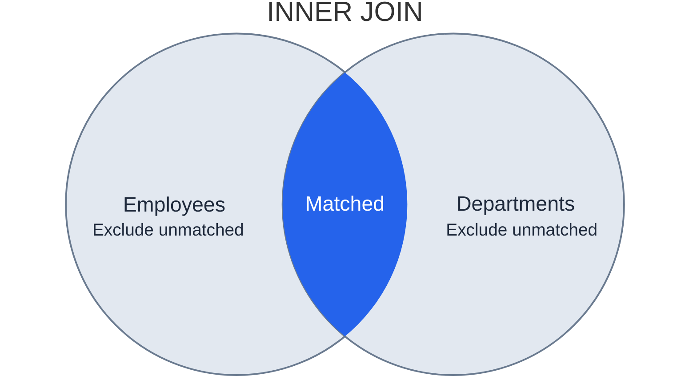
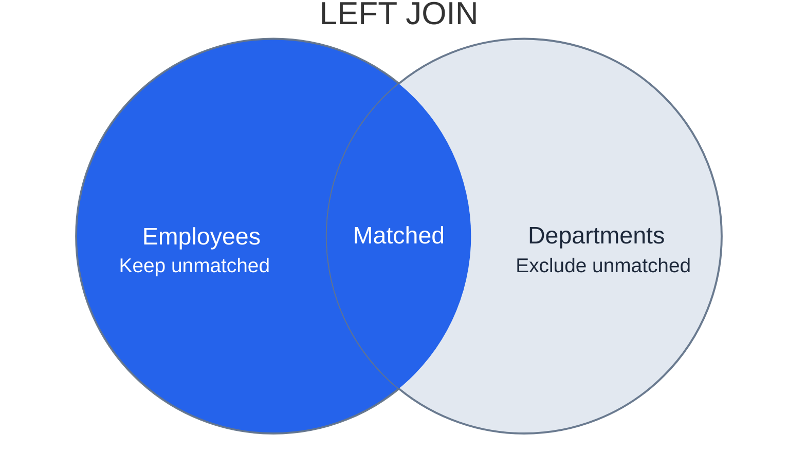
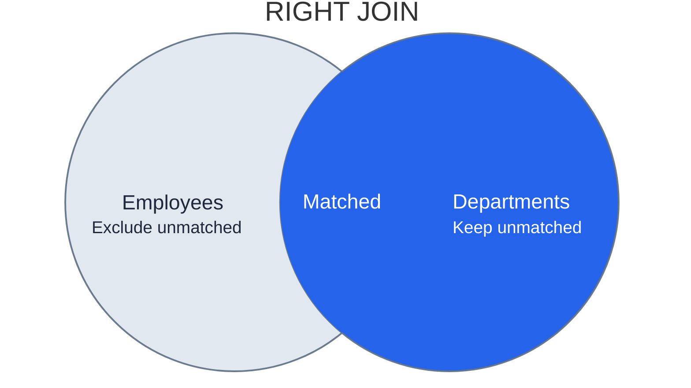
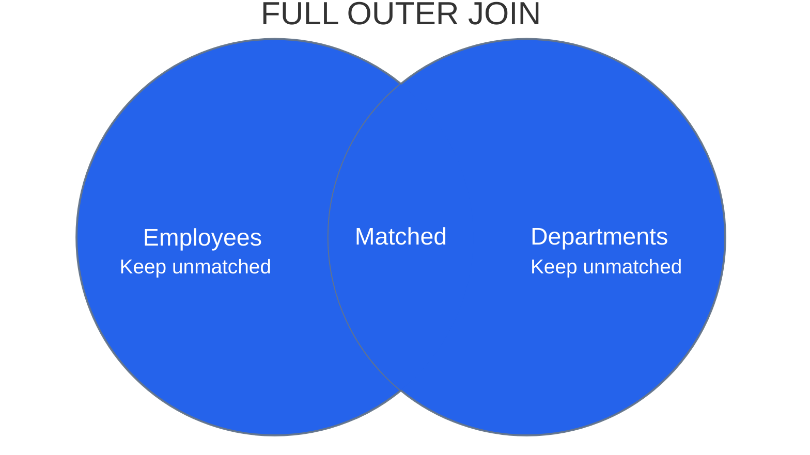

# 多表连接：INNER JOIN、LEFT JOIN、RIGHT JOIN、FULL OUTER JOIN、CROSS JOIN

[样例表](01-select-from-as.md)中，员工表保存部门编号，部门表保存部门名称。`JOIN` 根据条件匹配两边的行，让查询同时使用两张表的列。

以下四张文氏图分别标出连接的保留范围：蓝色区域表示保留，浅灰区域表示排除；`Keep`、`Exclude` 同时标明含义，交叠区表示匹配行对。

## INNER JOIN：只保留匹配行



```sql
SELECT
  e.employee_name,
  d.department_name
FROM
  Employees AS e
  INNER JOIN Departments AS d ON e.department_id = d.department_id;
```

`e`、`d` 是表别名，`e.department_id` 指员工表的部门编号。`ON` 指定匹配条件，单独写 `JOIN` 等同于 `INNER JOIN`。

Ada、Ben 匹配 Engineering，Cora、Eva 匹配 Design，共 4 行。Dan 没有匹配部门，Sales 没有匹配员工，都不出现。

## LEFT JOIN：保留左侧未匹配行



```sql
SELECT
  e.employee_name,
  d.department_name
FROM
  Employees AS e
  LEFT JOIN Departments AS d ON e.department_id = d.department_id;
```

结果在上述 4 行之外增加 `(Dan, NULL)`。左侧员工没有匹配时仍然保留，右侧列补 `NULL`。左右由表的书写位置决定：这里 `Employees` 是左表。

## RIGHT JOIN：保留右侧未匹配行



```sql
SELECT
  e.employee_name,
  d.department_name
FROM
  Employees AS e
  RIGHT JOIN Departments AS d ON e.department_id = d.department_id;
```

保留 4 个匹配行对，并增加 `(NULL, Sales)`，共 5 行；Dan 不出现。RIGHT JOIN 可以通过交换左右表改写成 LEFT JOIN。

## FULL OUTER JOIN：保留两侧未匹配行



```sql
SELECT
  e.employee_name,
  d.department_name
FROM
  Employees AS e
  FULL OUTER JOIN Departments AS d ON e.department_id = d.department_id;
```

保留 4 个匹配行对，再增加 `(Dan, NULL)` 与 `(NULL, Sales)`，共 6 行。未匹配记录缺少哪一侧，就在哪一侧补 `NULL`。

## 四种连接的保留范围

文氏图中的交叠区表示匹配部分，两侧非交叠区表示未匹配部分。它只帮助区分保留范围，不表示员工与部门记录真的属于同一种集合，也不表示输出行数。

固定员工为左表、部门为右表，均按部门编号相等匹配：

| 连接类型          | 匹配部分 | 左侧未匹配     | 右侧未匹配     | 本例结果         |
| ----------------- | -------- | -------------- | -------------- | ---------------- |
| `INNER JOIN`      | 保留     | 丢弃           | 丢弃           | 4 行             |
| `LEFT JOIN`       | 保留     | 保留，右列补空 | 丢弃           | 5 行，增加 Dan   |
| `RIGHT JOIN`      | 保留     | 丢弃           | 保留，左列补空 | 5 行，增加 Sales |
| `FULL OUTER JOIN` | 保留     | 保留，右列补空 | 保留，左列补空 | 6 行，两者都增加 |

`LEFT OUTER JOIN`、`RIGHT OUTER JOIN` 中的 `OUTER` 可以省略。文氏图使用 Mermaid 11.12.3+ 的 `venn-beta`；其中 `union` 定义交叠区，与 SQL 的 `UNION` 无关。[Mermaid 文氏图语法](https://mermaid.ai/open-source/syntax/venn.html)

## ON 和 WHERE：条件位置影响外连接

要保留所有部门，但只显示工资至少 7000 的匹配员工，把工资条件放在 `ON` 中：

```sql
SELECT
  d.department_name,
  e.employee_name
FROM
  Departments AS d
  LEFT JOIN Employees AS e ON d.department_id = e.department_id
  AND e.salary >= 7000;
```

结果为 `(Engineering, Ada)`、`(Design, NULL)`、`(Sales, NULL)`。这里的左表是部门表。

如果把条件放进 `WHERE`：

```sql
SELECT
  d.department_name,
  e.employee_name
FROM
  Departments AS d
  LEFT JOIN Employees AS e ON d.department_id = e.department_id
WHERE
  e.salary >= 7000;
```

结果只剩 `(Engineering, Ada)`。`ON` 决定哪些行可以匹配；`WHERE` 筛选连接后的行，工资未知的补空行也会被筛掉。

## 一对多与计数

一个部门可以匹配多名员工，连接后的部门信息会重复。连接不会自动去重，也不保证结果行数等于某一张表的行数。

统计部门人数时，应数匹配到的员工，而不是连接结果的全部行：

```sql
SELECT
  d.department_name,
  COUNT(e.employee_id) AS employee_count
FROM
  Departments AS d
  LEFT JOIN Employees AS e ON d.department_id = e.department_id
GROUP BY
  d.department_id,
  d.department_name;
```

Sales 没有员工，但左连接为它保留了一行。`COUNT(*)` 会把这行数成 1；`COUNT(e.employee_id)` 忽略补出的空值，得到正确人数 0。

## 自连接：一张表扮演两个角色

查询员工与经理姓名，两侧都使用员工表：

```sql
SELECT
  e.employee_name,
  m.employee_name AS manager_name
FROM
  Employees AS e
  LEFT JOIN Employees AS m ON e.manager_id = m.employee_id;
```

`e` 是员工，`m` 是经理；Ben 对应 Ada，Eva 对应 Cora。Ada、Dan 没有经理，因使用 LEFT JOIN 仍被保留。

自连接不是新的保留规则，也可以使用 INNER JOIN；此时没有匹配经理的员工会被排除。

## CROSS JOIN：所有行两两组合

```sql
SELECT
  e.employee_name,
  d.department_name
FROM
  Employees AS e
  CROSS JOIN Departments AS d;
```

5 名员工与 3 个部门产生 `5 × 3 = 15` 行。Ada 会分别与三个部门组合，Dan 也一样；它们是所有可能的配对，不是实际归属。CROSS JOIN 不使用 `ON` 匹配条件。
