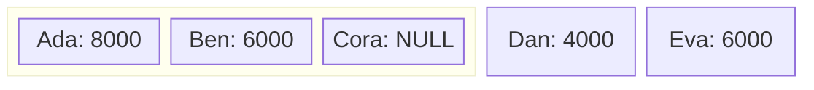

# 窗口函数：OVER、PARTITION BY、ROWS、ROW_NUMBER、RANK、DENSE_RANK、LAG、LEAD

[分组聚合](04-aggregate-group-by-having.md)把每组压成一行；窗口函数保留明细行，为每行计算一项统计。以下使用[员工样例](01-select-from-as.md)。

## OVER 与 PARTITION BY

为每名员工附加部门平均工资：

```sql
SELECT
  employee_name,
  department_id,
  salary,
  AVG(salary) OVER (
    PARTITION BY
      department_id
  ) AS department_average
FROM
  Employees;
```

| employee_name | department_id | salary | department_average |
| ------------- | ------------- | ------ | ------------------ |
| Ada           | 10            | 8000   | 7000               |
| Ben           | 10            | 6000   | 7000               |
| Cora          | 20            | NULL   | 6000               |
| Dan           | NULL          | 4000   | 4000               |
| Eva           | 20            | 6000   | 6000               |

`OVER` 指定窗口，`PARTITION BY` 把相同部门的行放入一个分区。结果仍为 5 行，平均值仍忽略未知工资。写成 `AVG(salary) OVER ()`，则每行得到整体平均值 6000。

## 行号与排名

```sql
SELECT
  employee_name,
  salary,
  ROW_NUMBER() OVER (
    ORDER BY
      salary DESC,
      employee_id
  ) AS row_no,
  RANK() OVER (
    ORDER BY
      salary DESC
  ) AS salary_rank,
  DENSE_RANK() OVER (
    ORDER BY
      salary DESC
  ) AS dense_salary_rank
FROM
  Employees
WHERE
  salary IS NOT NULL
ORDER BY
  salary DESC,
  employee_id;
```

| employee_name | salary | row_no | salary_rank | dense_salary_rank |
| ------------- | ------ | ------ | ----------- | ----------------- |
| Ada           | 8000   | 1      | 1           | 1                 |
| Ben           | 6000   | 2      | 2           | 2                 |
| Eva           | 6000   | 3      | 2           | 2                 |
| Dan           | 4000   | 4      | 4           | 3                 |

- `ROW_NUMBER`：每行一个不同序号，用员工编号打破同工资的平局。
- `RANK`：相同工资并列，后续名次跳号。
- `DENSE_RANK`：相同工资并列，后续名次不跳号。

工资排名的窗口中不加唯一编号，否则同工资也会被区分，不再并列。窗口内的排序决定计算顺序，最外层 `ORDER BY` 才决定结果展示顺序。

## 窗口框架与累计值

分区是参与计算的一批行，窗口框架是当前行实际使用的那一段。按编号累计工资：

```sql
SELECT
  employee_id,
  employee_name,
  SUM(salary) OVER (
    ORDER BY
      employee_id ROWS BETWEEN UNBOUNDED PRECEDING
      AND CURRENT ROW
  ) AS running_salary
FROM
  Employees
ORDER BY
  employee_id;
```

`ROWS BETWEEN UNBOUNDED PRECEDING AND CURRENT ROW` 表示从第一行到当前行。处理到 Cora 时，框架包含前三行：



内框对应当前参与累计的三行。Cora 的空工资不增加总和，所以她的累计值为 14000。五行累计结果依次为 8000、14000、14000、18000、24000。显式指定框架可以明确累计边界。

## LAG 与 LEAD：相邻行的值

```sql
SELECT
  employee_name,
  salary,
  LAG (salary) OVER (
    ORDER BY
      employee_id
  ) AS previous_salary
FROM
  Employees
ORDER BY
  employee_id;
```

`LAG` 默认取前一行，`LEAD` 默认取后一行。Ben 的上一行是 Ada，因此前一工资为 8000；Dan 的上一行是 Cora，因此得到 `NULL`。第一行没有前驱时也得到 `NULL`，不能据此判断上一行是否存在。

## 筛选窗口结果

同层 `WHERE` 先于窗口计算，不能使用刚生成的行号。将窗口结果放入 [CTE](06-subquery-in-exists-with.md)，再在外层筛选：

```sql
WITH
  numbered_employees AS (
    SELECT
      employee_name,
      salary,
      ROW_NUMBER() OVER (
        ORDER BY
          salary DESC,
          employee_id
      ) AS row_no
    FROM
      Employees
    WHERE
      salary IS NOT NULL
  )
SELECT
  employee_name,
  salary
FROM
  numbered_employees
WHERE
  row_no <= 2
ORDER BY
  row_no;
```

结果为 Ada、Ben。若要求“工资前两名，允许并列”，应改为按工资计算的 `DENSE_RANK`，结果还会包括 Eva。
