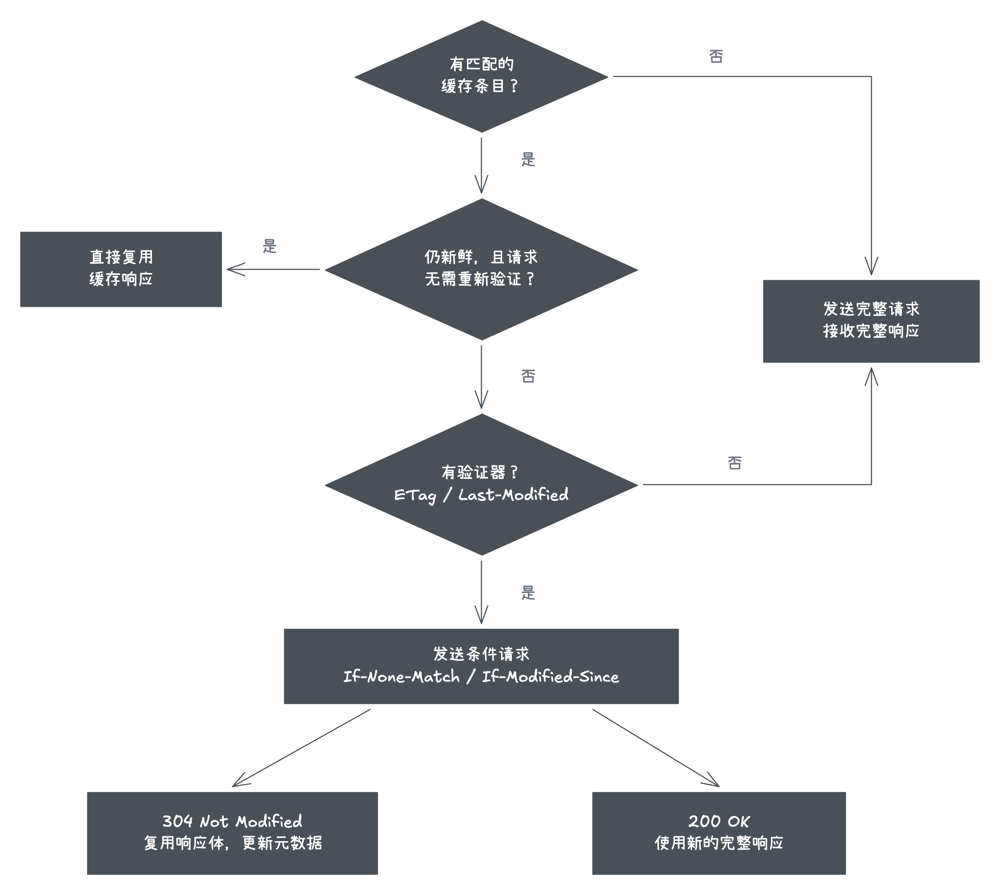

# HTTP 缓存：什么时候复用，什么时候问服务器

服务器上的 CSS 已经更新，用户为什么仍看到旧页面？一种常见原因是：浏览器手里的响应还在新鲜期内，这次根本没有向服务器询问。要解释它，需要沿着一次资源请求，区分直接复用、条件验证和完整获取。

HTTP 缓存保存的是响应正文及相关元数据。后续请求到来时，缓存先寻找匹配条目，再判断这份响应能否用于当前请求。浏览器、代理和 CDN 都可能参与 HTTP 缓存；下文先以浏览器缓存一个 CSS 文件为例。

## 第一次请求：获得一份可以复用的响应

假设服务器返回：

```http
HTTP/1.1 200 OK
Content-Type: text/css
Cache-Control: max-age=60
ETag: "style-v1"
```

浏览器可以保存正文、响应头以及计算新鲜度所需的信息。`max-age=60` 表示这份响应的新鲜度期限为 60 秒；ETag 是服务器提供的表示版本标识，供后续验证使用。收到 200 不等于一定会保存，是否允许存储还受请求方法、响应状态和 `no-store` 等规则影响。[RFC 9111：存储条件](https://www.rfc-editor.org/rfc/rfc9111.html#section-3)

ETag 与过期时间解决不同问题：前者帮助判断内容是否变化，后者决定什么时候通常可以不问服务器。

## 新鲜期内：通常直接使用已有正文

若请求匹配已有条目，响应仍然 fresh，且本次请求没有要求验证，浏览器通常直接复用正文。这次资源请求不会到达源服务器，因此服务器即使已把文件改成 v2，也没有机会告诉这次请求。

新鲜度不是从每次读取时重新倒计时。缓存会考虑响应生成、传输和驻留带来的 age，再与 freshness lifetime 比较；经过上游缓存的响应，可能到达浏览器时已经消耗了一部分期限。`Age` 可以提供线索，但不是浏览器所有缓存决策的完整记录。[RFC 9111：Freshness](https://www.rfc-editor.org/rfc/rfc9111.html#section-4.2)

这条通常所说的“强缓存”路径减少了网络往返，但也意味着服务端修改同一 URL，不会自动删除用户已经保存的新鲜响应。

## 需要验证时：询问内容是否变化

响应过期，或当前请求要求验证时，若有 ETag，浏览器可以发送：

```http
GET /style.css HTTP/1.1
If-None-Match: "style-v1"
```

服务器比较当前表示，产生两种结果：

| 服务器结果 | 浏览器接下来做什么 | 节省了什么 |
| --- | --- | --- |
| 未变化，返回 `304 Not Modified` | 更新缓存元数据，继续使用已有正文 | 不再传输完整正文，仍有网络往返 |
| 已变化，返回新的 `200` 与正文 | 使用新响应，并按存储规则决定是否更新缓存 | 本次需要传输正文 |

这就是常说的“协商缓存”。它描述验证过程，结果不保证一定是 304。没有可用验证器时，需要获取完整响应；浏览器不会因为看到了 `no-cache` 就替服务器生成 ETag。

另一组常见字段是 `Last-Modified` 与 `If-Modified-Since`，按修改时间验证。时间精度和服务器维护方式会影响其适用性；ETag 并不要求采用某种固定的哈希算法。两种条件同时出现时，服务器应优先处理 `If-None-Match`，不能在 ETag 不匹配后又靠日期条件错误返回 304。[RFC 9111：Validation](https://www.rfc-editor.org/rfc/rfc9111.html#section-4.3)

## 把三条路径放在一起



图中概括普通 GET 的成功路径，省略允许使用过期响应、离线和 HTTP 错误等分支；“完整获取”也不意味着响应一定允许存储。

“强缓存”和“协商缓存”不是先后检查的两个仓库。它们是同一条目在不同条件下的使用方式：能直接复用就省去请求，需要验证就询问服务器，没有可用条目或验证器时再获取完整响应。

## `no-cache` 与 `no-store` 为什么不同

| 响应指令     | 解决的问题         | 典型含义                                             |
| ------------ | ------------------ | ---------------------------------------------------- |
| `max-age=N`  | 新鲜度期限         | 响应 age 小于期限时通常可直接复用                    |
| `no-cache`   | 复用前的验证要求   | 可以存储，但复用前必须成功验证                       |
| `no-store`   | 是否允许存储       | 缓存不应存储该响应                                   |
| `private`    | 谁可以存储         | 允许浏览器等私有缓存，禁止共享缓存存储               |
| `s-maxage=N` | 共享缓存的新鲜度   | 对共享缓存优先于 max-age；不控制浏览器私有缓存的期限 |
| `public`     | 共享缓存的存储许可 | 在相应规则下明确允许共享缓存存储，不等于永远新鲜     |

因此，入口 HTML 使用 no-cache，仍可能借助 304 节省正文传输；no-store 则不应期待下一次从该响应建立的条目中复用。已有 `Expires` 的响应，在适用 max-age 时优先使用 max-age，而不是维护两份独立倒计时。

这些指令不能单独替代用户身份隔离、授权和敏感数据处理。尤其不能因为请求是 GET，就让不同用户共享私人接口响应。[RFC 9111：Cache-Control](https://www.rfc-editor.org/rfc/rfc9111.html#section-5.2)

## 同一个 URL 为什么也可能匹配不到

缓存匹配至少涉及请求方法与目标 URI，`Vary` 还会让响应按指定请求头区分。例如 `Vary: Accept-Encoding` 要求匹配时考虑客户端的压缩能力。`Vary: *` 不能通过普通的请求头比较匹配复用。

此外，浏览器可能按顶层站点等信息分区缓存。同一 URL 出现在不同站点，不保证共享同一缓存条目。这里要分别理解：`Vary` 描述响应匹配规则，缓存分区是浏览器的隔离策略；都不应简化成“只要 URL 相同就命中”。[RFC 9111：Vary](https://www.rfc-editor.org/rfc/rfc9111.html#section-4.1)、[Chromium 缓存分区说明](https://developer.chrome.com/blog/http-cache-partitioning)

## 读懂 Network、fetch 与刷新行为

DevTools 中的 memory cache / disk cache 描述实现上的存储来源，不是 HTTP 规范定义的两种复用语义。304 则是服务器验证后的网络响应，不能与前两者并列成三种“缓存类型”。

浏览器内部验证成功后，fetch 通常拿到合并后的 200 响应及完整缓存正文。因此 `response.status === 200` 和 body 非空，都不足以证明本次下载了完整正文。应对照 Network 中的实际请求与服务端日志；Resource Timing 的 transferSize、encodedBodySize 只是辅助证据。

普通刷新、强制刷新和 DevTools 的 Disable cache 会改变条件，不宜背成固定时间线。代码中的 `fetch(..., { cache })` 则可以表达更明确的请求意图：

| 请求 cache mode  | 主要意图                                                            |
| ---------------- | ------------------------------------------------------------------- |
| `default`        | 依照当前请求、响应和缓存状态处理                                    |
| `no-cache`       | 复用前验证，即使条目仍在新鲜期                                      |
| `reload`         | 获取新响应，并按规则更新缓存                                        |
| `no-store`       | 本次不读取缓存，也不存入缓存                                        |
| `force-cache`    | 优先使用匹配条目，包括过期条目；没有条目时访问网络                  |
| `only-if-cached` | 只查缓存；要求 same-origin 模式，未命中可能返回 504 或使 fetch 拒绝 |

请求选项与同名响应指令不是同一个配置位置，精确行为见 [Fetch Standard](https://fetch.spec.whatwg.org/#concept-request-cache-mode)。浏览器的 cache 选项也不应与 Next.js 服务端 fetch 的 Data Cache 混为一谈。

## 用缓存策略解释一次部署

入口 HTML 通常需要及时发现新版本，可以要求复用前验证；带内容哈希的静态资源则在内容变化时更换 URL，适合较长的 max-age，并可结合 immutable 表达新鲜期内内容不变的承诺。

部署时先上传新静态资源，再切换 HTML，并保留一段时间的旧资源，避免仍持有旧 HTML 的客户端请求旧 chunk 时遇到 404。

面试中若被问“服务器更新后为什么还是旧资源”，先说明当前请求能否直接复用，再讨论验证器和 URL 版本。若追问“304 是否更快”，应区分节省正文与节省网络往返，而不是将所有命中都当成零网络成本。

最后还要分清缓存对象：HTTP 缓存按协议复用响应；[Cache Storage](../pwa/cacheStorage.md)由脚本管理 Request / Response；[BFCache](../lifecycle/bfcache.md)恢复页面运行状态。它们不会因为都叫缓存，就具有相同的失效与恢复行为。
