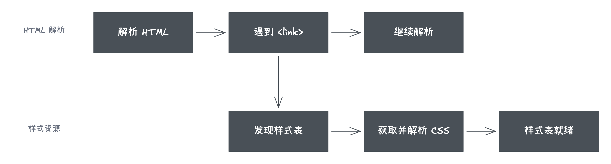
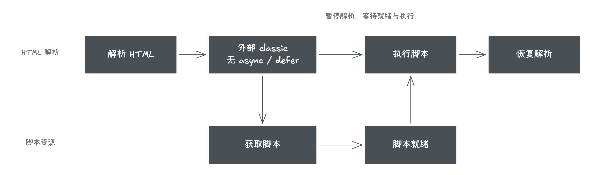
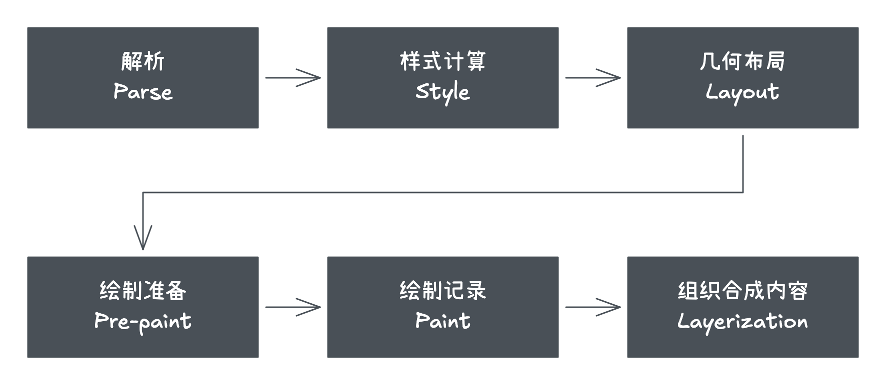
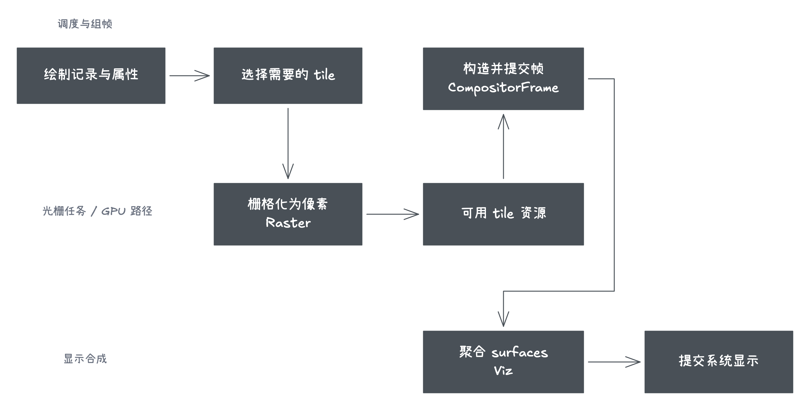

# 浏览器渲染：从文档到屏幕上的像素

修改元素的宽度后，浏览器怎样把这个变化显示出来？理解这件事，需要先走通从文档到像素的处理过程，再看后续更新能复用哪些结果，以及 JavaScript 读取尺寸为什么可能提前触发布局。

浏览器渲染需要区分“Web 规范”和“浏览器实现”两个层次：

- **Web 规范**：HTML、CSS Cascade、CSS Display 和 CSSOM View 等规范定义文档解析、层叠、盒生成以及几何 API 的可观察行为，但不要求浏览器采用完全相同的内部流水线。
- **Chromium/Blink 实现**：本文使用 Chromium 的 [RenderingNG](https://developer.chrome.com/docs/chromium/renderingng-architecture) 和 Blink [Paint 文档](https://chromium.googlesource.com/chromium/src/+/main/third_party/blink/renderer/core/paint/README.md)帮助理解主流实现。这些阶段和名称是工程实现，不应直接当成所有浏览器的内部结构。

以页面首次显示为例，可以把主流程概括为：

```text
HTML/CSS parse → style → layout → pre-paint → paint → layerize → tile → raster → composite → display
```

这是一条理解模型，不是每次更新都完整执行的固定流水线。浏览器会跟踪失效范围并复用已有结果；滚动或满足条件的合成动画可能只需要合成已有内容。HTML/CSS 解析主要为首次加载和后续新增内容提供输入，也不是每一帧都会重新执行。

首次渲染与后续更新可以这样区分：

| 场景 | 可能进入的阶段 | 说明 |
| --- | --- | --- |
| 首次加载页面 | parse → style → layout → pre-paint/paint/layerize → tile/raster → composite | 需要从资源和文档构建初始结构 |
| 修改 DOM 或影响布局的样式 | style → layout → pre-paint/paint → raster → composite | 通常只更新失效的范围，不重新解析整份 HTML |
| 只改变绘制外观 | style → pre-paint/paint → raster → composite | 例如普通元素的背景色发生变化，通常不需要重新布局 |
| 满足合成条件的属性变化 | composite | 可以复用已光栅化内容时，可能只更新合成属性 |

表格中的阶段仍是常见路径，不是属性与阶段的永久映射；浏览器可以根据失效范围、缓存和合成状态跳过部分工作。

## 1. Parse

HTML parser 将字节解码后的字符流转换成 token，并按照 HTML 纠错规则构建 DOM，具体算法见 WHATWG [Parsing HTML documents](https://html.spec.whatwg.org/multipage/parsing.html)。CSS parser 解析已加载的样式表并形成规则的内部表示；[CSSOM](https://drafts.csswg.org/cssom/) 则定义脚本如何访问和修改样式表，不应直接等同于 Blink 的全部内部样式数据结构。

浏览器还可以在主 parser 被脚本等工作阻塞时向前扫描可发现的 URL，提前请求 CSS、JavaScript、字体和图片。这通常称为 preload scanner 或 speculative parser；它表达的是“提前发现资源”的机制，不代表所有浏览器都必须创建一条固定的“预解析线程”。



> 图中两条泳道表达“资源发现、加载与主解析可以解耦”的概念关系，不是 Chromium 当前线程结构的严格示意。

外部样式表通常不会暂停 HTML parser 继续构建 DOM，但符合条件的 stylesheet 会成为 render-blocking 资源，从而延迟页面首次渲染。是否阻塞还会受到 `media`、加载方式和元素状态等条件影响，不能概括为“所有外部 CSS 都阻塞渲染”。

parser-inserted、没有 `async` 或 `defer` 的经典外部脚本通常会暂停 HTML 解析，等待脚本下载并执行。若它前面还有会阻塞脚本的样式表，脚本执行也需要等待这些样式表，因为脚本可能读取依赖样式的结果。脚本执行期间又可能通过 `document.write` 或 DOM API 修改正在构建的文档，因此 parser 不能简单越过它继续构建 DOM。



> 图中的资源加载泳道只表示获取工作可与主解析解耦；脚本的实际获取、编译与执行还涉及更多组件。

`async`、`defer` 与 module script 的差异详见 [Script Loading](../loading/script-loading.md)。

## 2. Style

浏览器根据 UA 样式、用户样式、作者样式、层叠、继承和选择器匹配，为需要渲染的节点计算 computed style。层叠规则由 [CSS Cascading and Inheritance](https://drafts.csswg.org/css-cascade/) 定义。

一个 CSS 属性从样式声明到实际显示，大致会经过以下值阶段：

| 阶段            | 含义                                               |
| --------------- | -------------------------------------------------- |
| declared values | 元素上所有可能参与层叠的声明值                     |
| cascaded value  | 根据来源、重要性、层、specificity 和顺序选出的结果 |
| specified value | 补上继承值或初始值后，属性确定的指定值             |
| computed value  | 解析继承和部分相对值后得到的结果，可供后代继承     |
| used value      | 结合包含块、字体度量和布局约束后实际用于布局的值   |
| actual value    | 考虑像素取整、设备和实现限制后最终使用的值         |

这些阶段是 CSS 规范的值处理模型，不等于 Blink 必须依次创建六份对象。computed value 也不一定是最终用于布局的数值：部分百分比尺寸需要在 Layout 阶段知道可用空间后才能确定 used value。因此，不应把 Style 理解成“所有 CSS 属性都已经转换成最终像素值”。

Style 的输出仍要交给 Layout 确定几何结果。`getComputedStyle()` 如何暴露这些值，以及读取是否会提前触发计算，放在[完整流程之后](#7-javascript-读取如何影响更新时机)讨论。

## 3. Layout

布局依据盒模型、格式化上下文、包含块、字体和内容，计算盒子的尺寸与位置。规范主要描述盒生成与布局结果；在 Blink 中，可以用 layout objects 和 fragments 理解其内部结果，但这些名称不是 Web 平台 API。

DOM 与布局结构不是一一对应：

- `display: none` 的元素仍存在于 DOM 中，但不会为自身及其后代生成布局盒；
- `::before`、`::after` 等伪元素可以产生布局内容，但不是普通 DOM 子节点；
- 一个 DOM 元素在行内换行、多列或分页时可能生成多个 fragment。

例如，`head`、`link` 等节点参与文档结构或提供资源信息，浏览器默认样式通常使它们不生成布局盒；反过来，块容器中直接出现的文本可能需要匿名盒参与排版。因此，“遍历 DOM，给每个节点算一个矩形”不足以描述布局。

盒生成、匿名盒和行盒的细节见 [CSS 盒模型](../../css/box/box-model.md)、[display](../../css/box/display.md) 与[行内格式化](../../css/text/inline-formatting.md)。这里继续关注布局输出怎样交给绘制阶段。

布局通常是增量进行的。DOM、样式或资源变化会使受影响的部分进入待更新状态，浏览器会尽量限制重新计算的范围，而不是每次都从头布局整个页面。

## 4. Pre-paint、Paint 与 Layerization

在现代 Blink 的理解模型中，顺序是 `layout → pre-paint → paint → layerization`，而不是旧资料中常见的 `layout → layer → paint`。

Pre-paint 主要为后续绘制准备 transform、clip、effect 和 scroll 等属性信息，并确定哪些已有绘制结果已经失效。Paint 再按照绘制顺序生成背景、边框、文字等绘制指令；它不是在调用页面的 Canvas API。

Blink 将这些绘制结果组织成 display items 和 paint chunks，整体结果常称为 Paint Artifact。随后，layerization 根据绘制内容及其属性决定如何组织交给 compositor 的内容。这里知道概念关系即可，具体内部数据结构可参考 Blink 的 [Paint architecture](https://chromium.googlesource.com/chromium/src/+/main/third_party/blink/renderer/core/paint/README.md)。

### Paint invalidation

页面已有绘制结果后，浏览器不需要在每次变化时重新记录整页。DOM、Style 或 Layout 的变化会标记可能需要重新绘制的对象和区域；Pre-paint 阶段检查这些失效信息，Paint 尽量复用仍然有效的绘制记录，只重新生成发生变化的部分。

需要区分几个相关但不同的动作：

| 动作                | 解决的问题                                   |
| ------------------- | -------------------------------------------- |
| style invalidation  | 哪些元素需要重新匹配规则或计算样式           |
| layout invalidation | 哪些盒子的尺寸、位置或 fragment 需要重新计算 |
| paint invalidation  | 哪些绘制记录已经不能复用                     |
| raster invalidation | 已有 tile 中哪些像素区域需要重新光栅化       |

独立 composited layer 不代表“该层变化时只处理该层，也不需要 Paint”。如果内容本身发生改变，该层仍可能需要新的绘制记录和像素；独立合成主要让某些变化能够限制失效范围，或只更新已有内容的合成属性。



> 图中采用现代 Blink 的 `pre-paint → paint → layerization` 顺序，表达处理阶段与结果的衔接，不表示这些工作全部发生在同一线程，也不表示每一帧都会完整执行全部阶段。

需要区分两个容易混淆的概念：

- **Stacking context** 主要约束元素的堆叠和绘制顺序，`z-index` 在满足定位等条件时参与其中；
- **Composited layer** 是浏览器为了光栅化、滚动、动画和合成而采用的实现组织方式。

二者可能相互影响，但不能互相推导：创建 stacking context 不保证得到独立 composited layer，独立合成也不只由 `z-index` 决定。动画、滚动、视频、Canvas、3D transform、内容重叠和资源成本等都可能影响 layerization，浏览器也可以随时调整策略。

`will-change` 只是对即将变化属性的提示，可能帮助浏览器提前准备优化，也可能增加纹理内存、合成和管理成本。应短期、针对性使用，并通过 DevTools Performance/Layers 验证实际结果。

## 5. Tiling、Raster、Composite 与 Display

Blink 主线程准备好可供合成使用的内容后，会把相关数据提交给 compositor。较大的绘制内容通常按 tile 管理，靠近视口以及显示当前帧所必需的 tile 往往具有更高处理优先级。

Raster 将绘制指令转换成像素内容。Chromium 可以根据平台、硬件能力和运行状态选择软件光栅或 GPU 光栅，因此不能把 Raster 简化成“必然由 GPU 完成”。

Compositor 根据 layer、tile、裁剪、滚动和 transform 等信息构造 draw quads。一个 draw quad 可以理解为“使用哪个已光栅化资源，以怎样的矩形、变换、裁剪和透明度参与本次合成”的描述；它不是再次执行页面的 Canvas 绘制代码。

这些 quads、render passes、资源引用和帧元数据被组织为 compositor frame。Renderer compositor 负责生成页面一侧的 frame，Chromium 的 Viz/display compositor 再聚合页面、跨进程 iframe 和浏览器 UI 等多个 surface，最后把结果提交给操作系统显示。整体架构可参考 Chromium [How cc Works](https://chromium.googlesource.com/chromium/src/+/main/docs/how_cc_works.md)。



> 图中 Raster、renderer compositor 与 Viz/display 的分工是概念化示意；实际光栅路径可以使用软件或 GPU，线程与进程分工也会随平台和 Chromium 版本变化。

### 主线程繁忙时，滚动为什么有时仍然流畅

compositor 能否独立滚动不是固定结论，需要满足相应条件：

- compositor 已经持有滚动节点、裁剪信息以及视口附近所需的 tile；
- 改变 scroll offset 不要求重新计算 Style、Layout 或 Paint；
- 输入没有落入必须等待主线程决定默认行为的区域，例如可能取消滚动的非 passive `touchstart`、`touchmove` 或 `wheel` 监听器；
- 本次交互不依赖同步 JavaScript、复杂命中测试结果或尚未提交给 compositor 的页面状态。

满足条件时，compositor 可以先更新 scroll offset、重组 quads 并提交新 frame，即使 Blink 主线程正在执行长任务。滚动位置之后仍会同步给主线程，`scroll` 事件和依赖滚动位置的 JavaScript 也仍需要主线程执行。

如果新区域没有可用 tile，用户可能短暂看到低分辨率内容或 checkerboarding；如果滚动导致 sticky 状态、内容或绘制结果发生主线程无法独立处理的变化，则仍然需要等待新的主线程提交。因此更准确的说法是“部分滚动可以 compositor-driven”，而不是“滚动与主线程无关”。

## 6. Reflow、Repaint 与 Composite

`reflow` 和 `repaint` 是常见的性能讨论术语；在浏览器文档和 DevTools 中，更常看到 Style、Layout、Paint、Raster 与 Composite 等具体阶段。下面表示常见路径，而不是 CSS 属性到流水线的永久映射：

| 变化 | 可能经过的主要阶段 | 示例 |
| --- | --- | --- |
| Layout/Reflow | style → layout → paint → raster → composite | 改变宽高、字体、文档流位置 |
| Repaint | paint → raster → composite | 改变背景色、边框、阴影 |
| Composite only | composite | 满足合成条件的 transform/opacity 动画 |

### 常见可能引起 Layout/Reflow 的属性

这类属性会改变盒子的尺寸、位置、排版约束或格式化结构，因此通常至少需要 Layout：

| 类别 | 常见属性 |
| --- | --- |
| 尺寸约束 | `width`、`height`、`min-width`、`max-width`、`min-height`、`max-height`、`aspect-ratio` |
| 盒模型间距 | `margin`、`padding`、`border-width`、`box-sizing` |
| 文档流与定位 | `display`、`position`、`inset`/`top`/`right`/`bottom`/`left`、`float`、`clear` |
| 文本排版 | `font-family`、`font-size`、`font-weight`、`line-height`、`letter-spacing`、`word-spacing`、`white-space` |
| Flex/Grid | `flex`、`flex-basis`、`order`、`grid-template-*`、`grid-auto-*`、`grid-column`、`grid-row`、`gap`、对齐属性 |
| 内容与书写方向 | `content`、`writing-mode`、`text-orientation` |

“引起 Layout”不等于“整页 reflow”。浏览器通常只标记可能受影响的布局边界和后代；某些声明如果没有改变 used value，也可能不产生实际布局变化。

### 常见可能只需要 Repaint 的属性

当盒子的几何结果没有变化时，下列视觉属性通常可以从 Paint 开始更新：

| 类别             | 常见属性                                                                      |
| ---------------- | ----------------------------------------------------------------------------- |
| 颜色与背景       | `color`、`background-color`、`background-image`、`background-position`        |
| 边框与轮廓外观   | `border-color`、`border-radius`、`outline-color`、`outline-style`             |
| 阴影与文字装饰   | `box-shadow`、`text-shadow`、`text-decoration-color`、`text-decoration-style` |
| 可见性与视觉效果 | `visibility`、部分 `filter`、`clip-path`、`mask` 变化                         |

这里的“只需要 Repaint”同样是常见情况，不是保证。例如 `border-style` 与 `border-width` 的组合可能改变 used border width；`filter`、`clip-path` 等可能走 Paint，也可能由 compositor 优化。`transform` 和 `opacity` 更适合单独归为 composite-only 的候选属性，但只有满足下文合成动画所述条件时才能跳过 Paint。

实际执行范围取决于元素是否参与布局、失效区域、已有缓存、是否独立合成以及浏览器优化。布局结果没有发生有效变化时，后续工作可能被跳过；绘制发生变化时，也可能只需要重新光栅化受影响的局部 tile。因此不应使用“reflow 一定完整 repaint 整个页面”之类的绝对表述。

### transform 与 opacity 为什么通常更快

如果元素的相关内容已经准备好，并且动画可以由 compositor 独立处理，改变 `transform` 或 `opacity` 通常能复用已有像素内容，只更新合成属性，从而跳过主线程的 Layout 和 Paint。这类情况通常称为 compositor-only animation。

但这不是属性本身提供的绝对保证：首次显示、未满足合成条件、内容失效、tile 未准备好，或与 filter、mask 等效果组合时，仍可能需要主线程工作和重新光栅化；过多合成内容也会增加内存与管理成本。

因此准确回答是“`transform` 和 `opacity` 更容易形成低成本的合成动画”，而不是“它们永远只走 GPU，与主线程无关”。

## 7. JavaScript 读取如何影响更新时机

JavaScript 读取到的不是一份统一的“页面最终结果”。不同 API 分别暴露样式声明、resolved value、布局几何或滚动状态；普通 Web API 不会直接返回 Blink 的 Paint Artifact、光栅化后的 tile 或 composited layer。

| 观测入口                                    | 与渲染流程的关系                                  |
| ------------------------------------------- | ------------------------------------------------- |
| `element.style`                             | 行内声明，是样式计算的输入，不代表层叠结果        |
| `getComputedStyle()`                        | 暴露 resolved value；部分属性还依赖 Layout 的结果 |
| `offsetWidth`、`getBoundingClientRect()` 等 | 基于布局几何；是否纳入 transform 取决于具体接口   |

接口的尺寸范围、坐标系、精度和特殊情况集中在 [DOM 几何读取](../dom/geometry.md#按尺寸范围与坐标系选择接口)，样式值的读取见 [DOM 样式读取](../dom/geometry.md#先区分样式声明与解析值)。这里关注这些读取为什么可能改变浏览器安排计算的时机。

### 读取是否一定触发同步布局

这些 API 返回哪个阶段的数据，与调用它们是否产生额外计算是两个问题：

- 如果 Style 和 Layout 已经是 clean，读取布局几何通常可以直接使用已有结果；
- 如果前面的 DOM/CSS 修改使 Style 或 Layout 处于 dirty 状态，读取依赖最新几何的 API 可能迫使浏览器在当前 JavaScript task 中同步结算；
- `getComputedStyle()` 至少可能要求样式更新；读取布局相关的 resolved value 时，还可能需要最新布局；
- 是否发生同步更新取决于当前文档状态和所读属性，不能只根据 API 名称判断。

```js
const box = document.querySelector(".box")

box.style.width = "200px" // Marks style/layout as dirty.
const width = box.offsetWidth // May force a synchronous style/layout update.
```

因此，性能问题通常不是“读取”本身，而是反复交错写入和读取，让浏览器无法批量处理更新。读写分组的示例与使用条件见 [DOM 几何读取](../dom/geometry.md#为什么读写交错可能迫使布局提前执行)。

## 8. 渲染什么时候发生

修改 DOM 或 CSSOM 通常只是使样式、布局或绘制状态失效，不代表像素会在该行 JavaScript 执行后立刻出现在屏幕上。当前 task 和随后的 microtask checkpoint 完成后，浏览器到达合适的 rendering opportunity，才可能执行 `requestAnimationFrame` 回调并完成当前需要的 Style、Layout、Paint 与 Composite 工作。

渲染不是每轮 Event Loop 都必然发生，后台页面、没有视觉变化或主线程繁忙时都可能跳过或推迟。反过来，在 JavaScript 中读取必须反映最新几何状态的 API，又可能要求浏览器在当前 task 内同步更新样式或布局。

任务、微任务、`requestAnimationFrame` 与渲染机会的具体关系见 [Browser Event Loop](../event-loop/event-loop.md)。

## 用一次修改串起整个过程

假设一个有可见背景的盒子已经显示，脚本将它的宽度从 `100px` 改为 `200px`。写入先让相关状态失效；Style 计算新的样式，Layout 根据约束确定盒子及受影响内容的尺寸与位置。Pre-paint 检查绘制属性与失效范围，Paint 更新需要重录的绘制指令，之后由 layerization、raster 与合成环节把需要更新的内容组织成新画面。这里列出的是解释路径，不表示所有阶段都会重新处理整个页面。

如果脚本在写入后立即读取 `offsetWidth`，浏览器可能必须先完成所需的样式和布局工作才能返回数值。但返回新宽度不表示新像素已经显示：绘制、光栅化、合成与系统呈现仍是后续工作。这个区别同时解释了“DOM 已经变了为什么还没显示”和“读尺寸为什么可能让当前 JavaScript 变慢”。

进一步可以比较两个场景：只改背景色时，哪些布局结果可以复用？内容不变、且动画满足合成条件时，改变 transform 又能复用哪些像素？回答时说明输入变化、最早失效的阶段和复用的结果，比背诵“某属性必定触发某阶段”更可靠。
