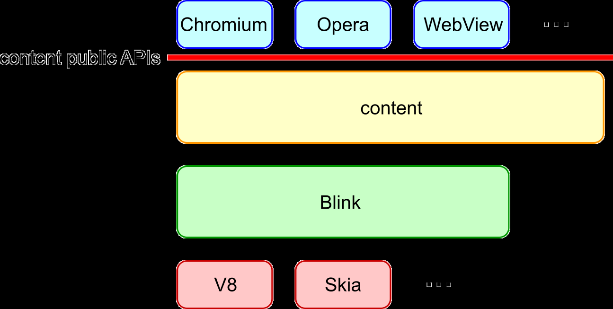
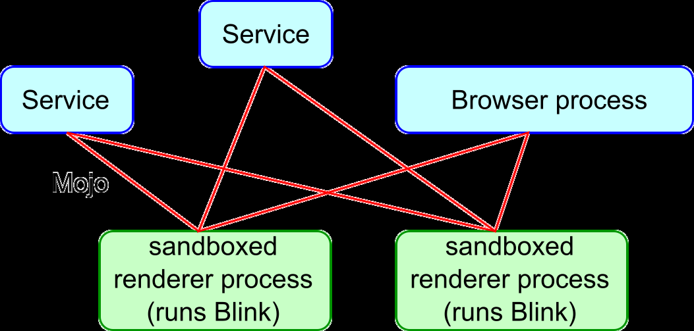
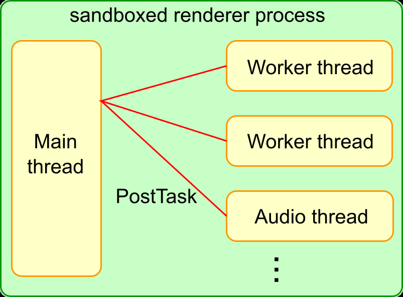
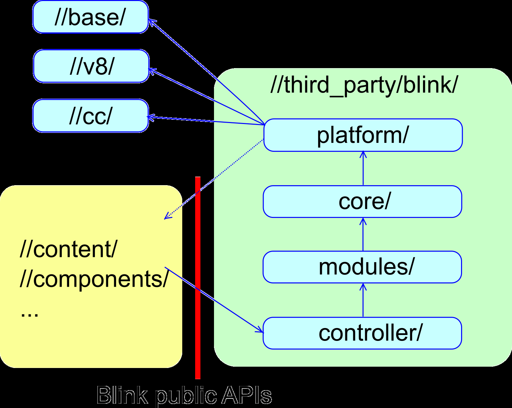
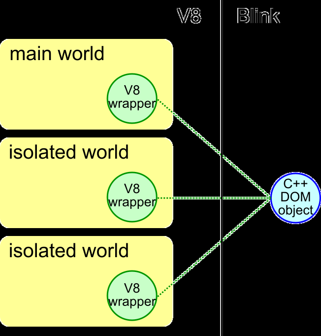
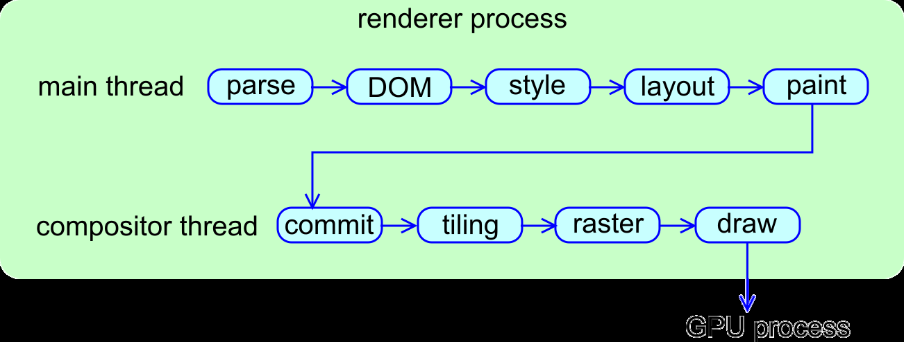

# Blink 的工作原理

> 英文原文：[How Blink works.pdf](<../en/rendering/How Blink works.pdf>) · [作者提供的入口](http://bit.ly/how-blink-works)。作者：haraken@；原文最后更新：**2018-08-14**；状态：PUBLIC；翻译日期：2026-10-09。本文完整翻译 PDF 正文，代码保留英文，修复 PDF 换行造成的断行，图示直接提取自原 PDF。

> 译注：这是一份历史架构入门材料。进程隔离策略、Oilpan 分配 API、V8 wrapper tracing、目录和类名可能已演进；不要直接将示例当作当前版本开发规范。较新的专题说明见[进程模型](../overview/process_model_and_site_isolation.md)、[线程与任务](../overview/threading_and_tasks.md)、[渲染核心](renderer-readme/core.md)。

开发 Blink 并不容易。对于新人，为构建高性能渲染引擎而引入的大量专有概念与编码约定增加了门槛；对于有经验的开发者，庞大的代码规模，以及对性能、内存、安全的高度敏感，也使工作充满挑战。

本文从整体介绍 Blink 如何工作，帮助开发者快速熟悉架构。它不试图全面教授容易变化的细节与编码规则，而是简洁描述短期内相对稳定的基础，并指向进一步阅读资料；它也不介绍 ServiceWorker、编辑等具体功能，而关注内存管理、V8 API 等在代码库广泛使用的基础能力。更多开发信息见 [Chromium Blink 页面](https://www.chromium.org/blink)。

## Blink 做什么

Blink 是 Web 平台的渲染引擎，大致实现浏览器标签页内内容渲染所需的能力：实现 HTML、DOM、CSS、Web IDL 等规范；嵌入 V8 执行 JavaScript；向底层网络栈请求资源；构建 DOM 树；计算样式与布局；嵌入 Chrome Compositor 并输出图形。

Chromium、Android WebView、Opera 等通过 Content public API 嵌入 Blink。



从代码角度，Blink 通常指 `//third_party/blink/`；从项目角度，通常指实现 Web 平台功能的项目，代码分布在 Blink、`//content/renderer/`、`//content/browser/` 等多个位置。

## 进程与线程架构

### 进程

Chromium 是多进程架构，一个 browser 进程加 N 个处于沙箱的 renderer，Blink 在 renderer 内运行。

创建多少 renderer？出于安全，需要隔离跨站文档的内存地址空间，即 Site Isolation。概念上，每个 renderer 最多服务一个站点。原文说明，当标签页太多或 RAM 不足时，严格一站点一进程成本可能过高，因此某些环境会让跨站 iframe、标签页共享 renderer。

一个标签页的 iframe 可能在不同进程，不同标签页的 iframe 也可能在同一进程。**Renderer、iframe、标签页之间没有一一对应关系。**

> 译注：上述“内存不足时跨站共享”是 2018 年材料的概括，不应套用到启用完整站点隔离的桌面 Chromium。进程软上限不会自动撤销安全隔离，具体见[进程复用与锁](../overview/process_model_and_site_isolation.md#process-reuse)。

Renderer 受沙箱限制，Blink 需请求 browser 代为完成文件访问、音频播放等系统操作，以及读取 cookie、密码等 profile 数据。Browser—renderer 通信通过 Mojo。历史上使用 Chromium IPC，原文指出它已弃用、底层也使用 Mojo，但仍有不少调用点。

Chromium 当时正在推进 Servicification，将 browser 抽象为服务集合。Blink 可通过 Mojo 与服务、browser 交互。



进一步阅读：[多进程架构](https://www.chromium.org/developers/design-documents/multi-process-architecture)、[Blink 中的 Mojo 编程](https://chromium.googlesource.com/chromium/src/+/main/third_party/blink/renderer/platform/mojo/MojoProgrammingInBlink.md)。

### 线程

Blink 有一个主线程、N 个 worker 线程和少量内部线程。几乎所有重要工作都在主线程：除 worker 外的 JavaScript、DOM、CSS、样式与布局计算。Blink 按这种主要单线程的架构高度优化主线程性能。

可创建多个线程运行 Web Worker、ServiceWorker、Worklet；Blink、V8 也可能为 Web Audio、数据库、GC 创建内部线程。

跨线程应通过 PostTask 消息传递。除确实出于性能需要的少量场景外，不鼓励共享内存编程，因此代码中很少看到 MutexLock。



进一步阅读：[线程编程](https://chromium.googlesource.com/chromium/src/+/main/third_party/blink/renderer/platform/wtf/ThreadProgrammingInBlink.md)、[Worker](https://chromium.googlesource.com/chromium/src/+/main/third_party/blink/renderer/core/workers/README.md)。

## Blink 的初始化与结束

`BlinkInitializer::Initialize()` 初始化 Blink，执行任何 Blink 代码前必须调用。

另一方面，原文中的 Blink 不执行完整 finalization：renderer 直接退出，不做全量清理。一方面为了性能；另一方面，以正确顺序优雅清理 renderer 的所有对象非常困难，也不值得付出相应代价。

## 目录结构

### Content Public API 与 Blink Public API

Content public API 让嵌入方接入渲染引擎。由于对外暴露，必须谨慎维护。

Blink public API 则向 Chromium 暴露 `//third_party/blink/` 的功能，是继承自 WebKit 的历史边界。当时 Chromium、Safari 共用 WebKit 实现，需要这一 API 层。原文指出，Chromium 成为 Blink 唯一嵌入方后，这层边界的必要性降低，因此通过 Onion Soup 项目，将 Web 平台代码从 Chromium 移入 Blink，减少 public API 数量。



### 目录与依赖

`//third_party/blink/` 中：

- platform/：从庞大 core 中分离的底层功能，如几何、图形工具。
- core/、modules/：实现规范定义的 Web 平台功能。Core 与 DOM 紧密耦合；modules 相对独立，例如 Web Audio、IndexedDB。
- bindings/core/、bindings/modules/：概念上分别属于 core、modules，集中放置大量使用 V8 API 的文件。
- controller/：使用 core、modules 的高层库，原文以 DevTools 前端相关代码为例。

依赖方向为：Chromium → controller → modules 与 bindings/modules → core 与 bindings/core → platform → `//base`、`//v8`、`//cc` 等底层组件。Blink 谨慎维护允许暴露给自身的底层组件名单。

更多目录定义见 [renderer README](https://chromium.googlesource.com/chromium/src/+/main/third_party/blink/renderer/README.md)。

## WTF

WTF 位于 platform/wtf/，是 Blink 专用的基础库。虽然尽量统一 Chromium 与 Blink 基础设施、保持 WTF 精简，部分类型、容器、宏仍需针对 Blink 工作负载及 Oilpan GC 优化。

若 WTF 已定义类型，Blink 应用它而非 base 或 std 的对应类型。例如 WTF::Vector、HashSet、HashMap、String、AtomicString，而非 std::vector、std::*set、std::*map、std::string。见 [WTF README](https://chromium.googlesource.com/chromium/src/+/main/third_party/blink/renderer/platform/wtf/README.md)。

## 内存管理

原文要求关注三类分配：PartitionAlloc、Oilpan（Blink GC），以及禁止直接使用的系统 malloc/free 或 new/delete。

通过 USING_FAST_MALLOC 在 PartitionAlloc 堆分配：

```cpp
class SomeObject {
  USING_FAST_MALLOC(SomeObject);
  static std::unique_ptr<SomeObject> Create() {
    return std::make_unique<SomeObject>();  // Allocated on PartitionAlloc's heap.
  }
};
```

生命周期应由 scoped_refptr 或 unique_ptr 管理，不鼓励手动管理，Blink 禁止手动 delete。

通过 GarbageCollected 在 Oilpan 堆分配，以下为原文历史写法：

```cpp
class SomeObject : public GarbageCollected<SomeObject> {
  static SomeObject* Create() {
    return new SomeObject;  // Allocated on Oilpan's heap.
  }
};
```

Oilpan 自动管理生命周期，持有对象需用 Member、Persistent 等特殊指针。最重要的限制之一是：Oilpan 对象的析构函数不能访问其他 Oilpan 对象，因为析构顺序不保证。

原文说明，不使用上述宏或基类会走系统 malloc，强烈不推荐；Blink 对象应使用 PartitionAlloc 或 Oilpan。默认选 Oilpan；仅在生命周期清晰、unique_ptr / scoped_refptr 足够，或使用 Oilpan 引入过多复杂度、额外 GC 压力时，才选 PartitionAlloc。

不论选择哪种，都要避免悬空指针与泄漏；原文也强烈不推荐裸指针。

> 译注：`new SomeObject` 是 2018 年示例，现代 Blink GC 代码应查阅当前 API，例如 `MakeGarbageCollected`，不要照搬历史分配方式。这里讨论的是原文的 Blink 分配约定，而非对所有 C++ new 表达式的一概禁止。

进一步阅读：[PartitionAlloc 分配约定](https://chromium.googlesource.com/chromium/src/+/main/third_party/blink/renderer/platform/wtf/allocator/Allocator.md)、[Blink GC API](https://chromium.googlesource.com/chromium/src/+/main/third_party/blink/renderer/platform/heap/BlinkGCAPIReference.md)、[GC 设计](https://chromium.googlesource.com/chromium/src/+/main/third_party/blink/renderer/platform/heap/BlinkGCDesign.md)。

## 任务调度

为保持响应，Blink 任务应尽可能异步执行。不鼓励同步 IPC / Mojo 或可能占用数毫秒的操作，虽然用户 JavaScript 等有时无法避免。

Renderer 的任务应以正确 TaskType 投递给 Blink Scheduler：

```cpp
// Post a task to frame's scheduler with a task type of kNetworking
frame->GetTaskRunner(TaskType::kNetworking)->PostTask(..., WTF::Bind(&Function));
```

Scheduler 维护多个队列并确定优先级，以改善用户感知性能。正确指定任务类型，是它做出恰当调度的前提。见 [TaskSchedulingInBlink](https://chromium.googlesource.com/chromium/src/+/main/third_party/blink/renderer/platform/scheduler/TaskSchedulingInBlink.md)。

## Page、Frame、Document、DOMWindow

### 概念

- 不考虑下文 OOPIF 时，Page 大致对应标签页，一个 renderer 可有多个 Page。
- Frame 对应主 frame 或 iframe，一个 Page 的多个 Frame 构成树。
- DOMWindow 对应 JavaScript window。
- Document 对应 window.document。
- ExecutionContext 抽象主线程的 Document 与 worker 线程的 WorkerGlobalScope。

原文关系为 renderer : Page = 1:N，Page : Frame = 1:M；在任一时刻，Frame : DOMWindow : Document（或 ExecutionContext）= 1:1:1，但随时间可改变。例如：

```js
iframe.contentWindow.location.href = "https://example.com";
```

新页面通常产生新的 DOMWindow、Document，但 Frame 可复用。更精确地说，也有只换 Document、复用 DOMWindow 和 Frame 的情况，还有更复杂场景。见 [FrameLifecycle](https://chromium.googlesource.com/chromium/src/+/main/third_party/blink/renderer/core/frame/FrameLifecycle.md)。

### 进程外 iframe（OOPIF）

Site Isolation 改善安全，也增加复杂度。其思路是按 site 分隔 renderer。Site 使用 scheme 与可注册域，例如 https://mail.example.com 和 https://chat.example.com 同站，noodles.com 与 pumpkins.com 不同站。

如果 Page 包含跨站 iframe，可能跨两个 renderer：

```html
<!-- https://example.com -->
<body>
<iframe src="https://example2.com"></iframe>
</body>
```

本进程的 frame 由 LocalFrame 表示，其他进程的 frame 由 RemoteFrame 表示。主 frame 看自己是 LocalFrame、iframe 是 RemoteFrame；iframe 所在进程则反过来。LocalFrame 与 RemoteFrame 之间的通信经 browser 中转。

进一步阅读：[站点隔离设计](https://www.chromium.org/developers/design-documents/site-isolation)、[Blink 中面向隔离的编码](https://chromium.googlesource.com/chromium/src/+/main/third_party/blink/renderer/core/frame/SiteIsolation.md)。

### 已分离的 Frame / Document

Frame、Document 可以处于 detached 状态：

```js
doc = iframe.contentDocument;
iframe.remove();  // The iframe is detached from the DOM tree.
doc.createElement("div");  // But you still can run scripts on the detached frame.
```

难点是分离后仍可能执行脚本或 DOM 操作。原文指出，许多依赖 frame 的操作应失败并抛出适当异常，当时跨浏览器行为和规范描述还不完善。例如：

```cpp
void someDOMOperation(...) {
  if (!script_state_->ContextIsValid()) { // The frame is already detached
    …;  // Set an exception etc
    return;
  }
}
```

> 译注：原文概括为“大多数 DOM 操作失败”，不能据此推断脱离文档的普通节点不可操作。例中的 createElement 与依赖活动 frame、有效 V8 context 的 API 需要分开判断。

因此 Blink 常需在 frame 分离时清理，可继承 ContextLifecycleObserver：

```cpp
class SomeObject : public GarbageCollected<SomeObject>, public ContextLifecycleObserver {
  void ContextDestroyed() override {
    // Do clean-up operations here.
  }
  ~SomeObject() {
    // It's not a good idea to do clean-up operations here because it's
    // too late to do them. Also a destructor is not allowed to touch any
    // other objects on Oilpan's heap.
  }
};
```

## Web IDL 绑定

JavaScript 访问 node.firstChild 时，如何调用到 C++ 的 Node::firstChild？首先按照规范定义 IDL：

```webidl
// node.idl
interface Node : EventTarget {
  [...] readonly attribute Node? firstChild;
};
```

Web IDL 规范定义语法。`[...]` 表示 extended attribute，一部分来自规范，一部分为 Blink 扩展。除 Blink 扩展之外，IDL 应遵循规范，通常可直接复制规范声明。

然后实现 C++ 类及 getter：

```cpp
class EventTarget : public ScriptWrappable {  // All classes exposed to JavaScript must inherit from ScriptWrappable.
  ...;
};

class Node : public EventTarget {
  DEFINE_WRAPPERTYPEINFO();  // All classes that have IDL files must have this macro.
  Node* firstChild() const { return first_child_; }
};
```

通常这样即可。构建 node.idl 时，IDL compiler 自动生成 Node、firstChild 的 Blink—V8 bindings。原文输出路径为 `//src/out/{Debug,Release}/gen/third_party/blink/renderer/bindings/core/v8/v8_node.h`。JS 访问时，V8 调用生成的 V8Node::firstChildAttributeGetterCallback，再调用上述 C++ getter。

进一步阅读：[IDLCompiler](https://chromium.googlesource.com/chromium/src/+/main/third_party/blink/renderer/bindings/IDLCompiler.md)、[扩展属性](https://chromium.googlesource.com/chromium/src/+/main/third_party/blink/renderer/bindings/IDLExtendedAttributes.md)、[Web IDL 规范](https://webidl.spec.whatwg.org/)。

## V8 与 Blink

### Isolate、Context、World

使用 V8 API 前需理解这三个概念，分别对应 v8::Isolate、v8::Context、DOMWrapperWorld。

原文中的 Blink 将 Isolate 与物理线程一一对应：主线程和每个 worker 线程各有自己的 Isolate。Context 对应全局对象，frame 中即 window；一个 renderer 的多个 frame 因而有多个 context。调用 V8 API 必须处于正确 context，否则 GetCurrentContext 返回错误上下文，最坏会泄漏对象并造成安全问题。

World 用来支持 Chrome 扩展 content script，并非 Web 标准概念。Content script 希望共享网页 DOM，但其 JS 对象必须与网页及其他扩展隔离。主线程因此具有网页的 main world 和扩展使用的 isolated world。它们访问同一组 C++ DOM 对象，却拥有独立 JS 包装对象：一个 C++ DOM 对象在每个 world 对应一个 V8 wrapper。



若主线程有 N 个 world，一个 frame 就有 N 个分别服务各 world 的 window。M 个 frame、N 个 world，最多对应 M×N 个 context，按需创建。Worker 在原文模型中只有一个 world、一个全局对象、一个 context。

因此必须使用正确 context，避免在 isolated world 之间泄漏 JS 对象，例如让一个来源的扩展操纵另一个扩展。

> 译注：“独立 JS 堆”是原文用于解释可见性隔离的说法，不表示每个 world 都有独立操作系统进程或独立 Isolate。Isolate 与线程的关系也应结合具体 Blink 线程类别，而非推广为 V8 API 的普遍强制规则。

进一步阅读：[V8BindingDesign](https://chromium.googlesource.com/chromium/src/+/main/third_party/blink/renderer/bindings/core/v8/V8BindingDesign.md)。

### V8 API

原文的 `//v8/include/v8.h` 包含大量底层 API，难以正确使用。platform/bindings 提供包装它们的辅助类，应尽量复用；大量使用 V8 API 的代码应放在 bindings/core 或 bindings/modules。

V8 通过 handle 指向对象。最常见的 v8::Local 用于从机器栈引用 V8 对象，需先在栈上创建 HandleScope，不能将 Local 放在栈外：

```cpp
void function() {
  v8::HandleScope scope;
  v8::Local<v8::Object> object = ...;  // This is correct.
}

class SomeObject : public GarbageCollected<SomeObject> {
  v8::Local<v8::Object> object_;  // This is wrong.
};
```

栈外引用需要原文所述 wrapper tracing，并小心循环引用。不确定时应向 blink-review-bindings@ 寻求评审。见 [HowToUseV8FromBlink](https://chromium.googlesource.com/chromium/src/+/main/third_party/blink/renderer/platform/bindings/HowToUseV8FromBlink.md)。

### V8 Wrapper

每个 C++ DOM 对象在每个 world 有对应 wrapper。原文说明 wrapper 强引用 C++ 对象，而 C++ 对象仅弱引用 wrapper。如果需保持 wrapper 存活，就必须显式建立机制，否则它可能过早回收，丢失 JS 附加属性。

以下是原文的假设性说明，展示“若没有保活机制会怎样”：

```js
div = document.getElementbyId("div");
child = div.firstChild;
child.foo = "bar";
child = null;
gc();  // If we don't do anything, the V8 wrapper of |firstChild| is collected by the GC.
assert(div.firstChild.foo === "bar");  //...and this will fail.
```

> 译注：代码保留原文 `getElementbyId` 拼写，实际 DOM API 为 `getElementById`；gc() 也不是普通网页默认可用 API。这段不是声称真实浏览器会丢失 foo，而是在说明引擎为什么需要跨堆可达性追踪。

为避免属性丢失，需要“只要 div 所属 DOM 树从 V8 可达，就保持 firstChild wrapper 存活”的机制。原文介绍 ActiveScriptWrappable 与 wrapper tracing 两种方式。

进一步阅读：[V8Wrapper](https://chromium.googlesource.com/chromium/src/+/main/third_party/blink/renderer/bindings/core/v8/V8Wrapper.md)、[TraceWrapperReference](https://chromium.googlesource.com/chromium/src/+/main/third_party/blink/renderer/platform/bindings/TraceWrapperReference.md)。这些为历史资料路径，阅读现代 GC 时需核对迁移情况。

## 渲染流水线

HTML 到达 Blink 后，距离屏幕显示像素还有很长的流程，其架构如下：



原作者推荐 [Life of a Pixel 演示文稿](https://docs.google.com/presentation/d/1boPxbgNrTU0ddsc144rcXayGA_WF53k96imRH8Mp34Y/edit#slide=id.p)，逐阶段理解流水线。

继续阅读：[DOM](renderer-readme/dom.md)、[样式](renderer-readme/css.md)、[布局](renderer-readme/layout.md)、[绘制](renderer-readme/paint.md)、[Chromium Graphics](https://www.chromium.org/developers/design-documents/chromium-graphics)。

## 提问渠道

一般问题可向 [blink-dev@chromium.org](https://groups.google.com/a/chromium.org/forum/#!forum/blink-dev) 提问，架构问题可向 [platform-architecture-dev@chromium.org](https://groups.google.com/a/chromium.org/forum/#!forum/platform-architecture-dev) 提问。

> 译注：PDF 中以下资料路径在本次本地源码快照已不存在：`MojoProgrammingInBlink.md`、`ThreadProgrammingInBlink.md`、`BlinkGCDesign.md`、`FrameLifecycle.md`、`SiteIsolation.md`、`HowToUseV8FromBlink.md`、`V8Wrapper.md`。上文保留这些历史引用以便对照原文；继续学习时优先使用[学习路线](../learning-path.md)中的已核对入口。图中的英文术语保持原图，下文或邻近正文提供中文解释。
