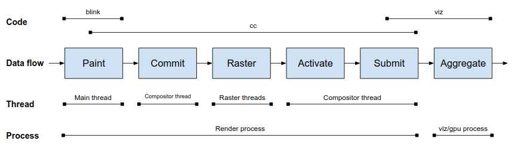
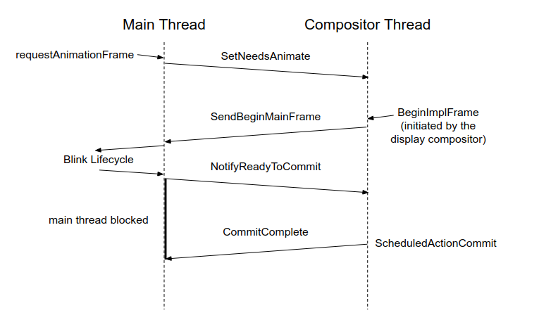
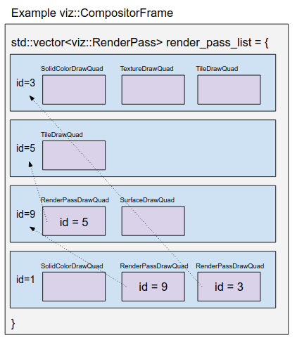

> 英文原文：[Chromium 来源](https://chromium.googlesource.com/chromium/src/+/f5a9dd28d9af3a5450afb58ac199223fc6b49976/docs/how_cc_works.md)。对应本地源码提交 `f5a9dd28d9af`（2026-09-12）；翻译日期：2026-10-09。代码、标识符及源码注释保留原样，译者补充以“译注”标识。

# cc 的工作原理

[原始 Google 文档](https://docs.google.com/document/d/1yjzOWrPfFGviEd1nru3yzqxSHETC-zsEBSt9C8SvV-Q/edit)

原文列出的其他译本：[中文](https://zhuanlan.zhihu.com/p/54601110) | [韩文](https://github.com/naver/whale-browser-developers/blob/master/translation/chromium/docs/how_cc_works.md)

> 译注：本文保留原文的设计与实现语境，其中 Slimming Paint 迁移、VideoLayer、栅格化后端、线程模式等描述具有历史背景。源码 checkout 较新不代表其中每段文字都同步更新；阅读时应结合具体版本源码。

- [简介](#tldr)
- [进程与线程架构](#process--thread-architecture)
- [内容数据流概览](#content-data-flow-overview)
- [输入数据流概览](#input-data-flow-overview)
- [Commit 流程](#commit-flow)
- [图层](#layers)
  - [属性树](#property-trees)
  - [PictureLayer](#picturelayer)
    - [直接合成的图片](#directly-composited-images)
  - [TextureLayer](#texturelayer)
  - [SolidColorLayer](#solidcolorlayer)
  - [VideoLayer](#videolayer)
  - [SurfaceLayer](#surfacelayer)
  - [SolidColorScrollbarLayer](#solidcolorscrollbarlayer)
  - [Painted(Overlay)ScrollbarLayer](#paintedoverlayscrollbarlayer)
  - [HeadsUpDisplayLayer](#headsupdisplaylayer)
  - [UIResourceLayer / NinePatchLayer](#uiresourcelayer--ninepatchlayer)
- [树：Commit 与 Activation](#trees-commit--activation)
- [栅格化与图块管理](#raster-and-tile-management)
  - [图像解码](#image-decoding)
  - [RasterBufferProvider](#raster-buffer-providers)
- [动画](#animation)
- [cc/paint/](#ccpaint)
- [调度](#scheduling)
- [Compositor Frame、Render Pass 与 Quad](#compositor-frames-render-passes-quads)
- [术语表](#glossary)
- [其他资源](#other-resources)
- [其他边界情况](#miscellaneous-corner-cases-that-dont-fit-anywhere-else-sorry)
  - [Damage](#damage)
  - [Mask Layer](#mask-layers)
  - [Impl](#impl)

## 简介

[cc/](https://cs.chromium.org/chromium/src/cc/) 历史上被称为 Chrome Compositor，但这个名称并不准确：它不是 Chrome 唯一的合成器，而且如今甚至不直接承担最终合成。danakj 建议称其为 content collator，即内容汇集器。

Browser 进程通过 ui/compositor 或 Android 代码嵌入 cc；renderer 则通过 Blink / RenderWidget 嵌入。cc 接收嵌入方的绘制输入，判断内容是否及在何处出现在屏幕上，对其中的图像执行栅格化、解码和动画更新，形成 GPU 纹理，再以 compositor frame 形式交给显示合成器。

cc 还处理 browser 转发的输入，无需经过 Blink 即可快速响应双指缩放和滚动。

## 进程与线程架构

cc 可采用单线程或多线程模式。单线程开销较低；多线程有额外延迟，但能在一条线程繁忙时，由另一条线程响应输入和动画。原文中 browser 通常使用单线程，因为主线程工作较轻；renderer 通常使用多线程，因为 Blink 主线程可能很忙。

两种模式均由 [cc::Scheduler](#scheduling) 决定何时提交帧。例外是 Blink web test 和 sim test：它们不总使用 scheduler，而可通过 `LayerTreeHost::CompositeForTest` 同步要求 cc 合成。这既有历史原因，也便于测试控制。

## 内容数据流概览

嵌入方主要通过由 `LayerTreeSettings` 配置的 `LayerTreeHost`，以及 [Layer](#layers) 组成的[树](#trees-commit-activation)与 cc 交互。Layer 是一块矩形内容，附带决定其屏幕呈现方式的属性。cc 把 PaintRecord 等绘制描述转为软件位图或 GPU 纹理，并确定矩形的屏幕位置。

cc 通过 PropertyTreeBuilder 将图层树输入转换为属性树，并把图层树简化为有序的可见图层列表。原文中 Slimming Paint 项目计划让 Blink 直接设置属性树与图层列表，跳过历史图层树接口及相应转换。

[Commit](#commit-flow) 将主线程数据传入合成器线程的数据结构。cc 判断各层可见部分，解码图片并[栅格化](#raster-and-tile-management)。内容准备好后，[激活](#trees-commit-activation)已提交的树，随后可从中“绘制”。

cc 仍在许多位置使用 draw、swap 术语，虽然它已不直接执行最终绘制或交换。这里 draw 指构造包含 quad 和 render pass 的 [compositor frame](#compositor-frames-render-passes-quads)；swap 指通过 CompositorFrameSink 提交给显示合成器。帧最终到达 Viz 的 SurfaceAggregator，与所有帧生产者的结果聚合。

## 输入数据流概览

另一类主要输入是点击、滚轮和触摸手势。Renderer 中由 browser 转发，经 `ui::InputHandlerProxy`（一个 `cc::InputHandlerClient`）处理。

部分输入在特定时机转给 `LayerTreeHostImpl`（一个 `cc::InputHandler`），以修改活动树属性，执行滚动或缩放。有些输入不能由合成器线程独立处理，例如存在同步 JavaScript touch / wheel handler 时，就继续转给 Blink。此流向与内容数据流相反。

## Commit 流程

Commit 将数据原子地从主线程传给合成器线程。单线程模式也需要把数据移入正确的数据结构。它通过阻塞主线程、复制数据实现，而不是发送 IPC。

主线程有多种方式请求 commit。网页常通过 `requestAnimationFrame` 最终调用 `LayerTreeHost::SetNeedsAnimate`。修改 cc 输入，例如图层 transform 或内容，会调用 `SetNeedsAnimate`、`SetNeedsUpdate`、`SetNeedsCommit` 之一。不同入口允许在发现没有工作时于不同阶段提前退出。例如 rAF 回调没有产生变化，就无需更新图层或 commit。如果当前不在处理 BeginMainFrame，这些入口都会向 scheduler 请求一次。

Scheduler 随后产生 `ScheduledActionBeginMainFrame`，将 BeginFrameArgs 从合成器线程发给主线程。参数包含动画时间，以及 Blink 尚不知道的合成器线程滚动增量，后者通常来自用户手势。Blink 嵌入 cc 时，会先应用滚动增量，再执行 rAF，并完成 Blink 部分的[渲染生命周期](https://docs.google.com/document/d/1aitSOucL0VHZa9Z2vbRJSyAIsAz24kX8LFByQ5xQnUg/edit#)。

接着 cc 更新全部图层。如果发现无需进一步工作，例如同步滚动位置后 Blink 没有改变页面，可以提前中止 commit。原文中的单线程 cc 不会提前中止。嵌入方完成 BeginMainFrame 且未中止后，ProxyMain 同步发送 `NotifyReadyToCommit`，将一个互斥同步对象交给合成器线程并阻塞。

Scheduler 准备提交时发出 `ScheduledActionCommit`。ProxyImpl 在主线程阻塞期间，将数据复制到合成器线程结构，随后释放同步对象，让主线程继续。

ProxyImpl 是唯一同时访问两侧数据结构的类，只在主线程阻塞时访问主线程的 LayerTreeHost、Layer，并以 getter 中的 DCHECK 强制检查。主线程对应对象是由 LayerTreeHost 持有的 ProxyMain。单线程模式由 SingleThreadProxy 承担两者职责。

## 图层

Layer 是具有整数边界的二维内容矩形，带有 transform、clip、effect 属性，决定其外观。

主线程层次继承 `cc::Layer`；合成器线程 pending、active、recycle 树的层次继承 `cc::LayerImpl`。两者大致一一对应，例如 SurfaceLayer / SurfaceLayerImpl、PictureLayer / PictureLayerImpl，下文通常将这些成对类型一起讨论。

主线程 Layer 使用引用计数：LayerTreeHost 持有根，父层递归持有子层。Blink 的媒体系统、插件等也会提供 layer，因此需要共享所有权。合成器线程上的 layer 则以 `unique_ptr` 由父级持有。

### 属性树

cc 支持两种层级属性输入。历史方式，也是 ui/ 使用的方式，是提供图层树：父层的变换、裁剪和效果递归影响子层。但它有 fixed 定位、scroll parent / child 等[边界情况](https://docs.google.com/presentation/d/1V7gCqKR-edNdRDv0bDnJa_uEs6iARAU2h5WhgxHyejQ/edit#slide=id.g1c810b6196_0_68)，还需频繁遍历大树、计算全部属性，性能不佳。

[属性树](https://docs.google.com/presentation/d/1V7gCqKR-edNdRDv0bDnJa_uEs6iARAU2h5WhgxHyejQ/edit?usp=sharing)将其拆为 transform、clip、effect 等独立树。每层保存自己使用的属性节点 ID，使更新复杂度从 `O(layers)` 变为 `O(interestingNodes)`。此时也不再需要图层树，可使用有序列表。

### PictureLayer

包含以 `cc::PaintRecord` 表示的绘制内容，并负责确定栅格化比例。每个比例由一个 `PictureLayerTiling` 表示，即该比例下稀疏、规则的二维图块网格。

每块是 `cc::Tile`，代表潜在内容，由 [TileManager](#raster-and-tile-management) 组织栅格化。在 [DevTools Rendering 设置](https://developer.chrome.com/devtools/docs/rendering-settings)中启用 composited layer borders 可查看边界。尺寸由启发式决定；原文举例软件图块约 `256×256` 像素，GPU 图块约视口宽度乘四分之一视口高度。

何时、如何改变栅格化比例也有许多启发式规则，并不完美，修改时需谨慎。🐉🐉🐉

#### 直接合成的图片

这是 PictureLayerImpl 的特殊栅格化模式。如果 DisplayItemList 只有一个 `drawImageRect` DrawOp，便使用不同逻辑决定图片比例。图层在固定比例栅格化，以提高缩放效率；默认按图片固有尺寸选择比例，再根据它与理想比例的接近程度调整。见 `PictureLayerImpl::ShouldAdjustRasterScale`、`RecalculateRasterScales`。

### TextureLayer

用于插件、自行栅格化的 canvas 和 WebGL。Texture 通常是 GPU 纹理引用；软件合成时则为共享内存位图。

### SolidColorLayer

已知内容只有纯色时，无需消耗栅格化工作或 GPU 纹理内存，是针对简单内容的优化。

### VideoLayer

原文指出它已因 [surfaces for video](https://docs.google.com/document/d/1tIWUfys0fH2L7h1uH8r53uIrjQg1Ee15ttTMlE0X2Ow/edit) 项目而弃用，计划最终删除。

### SurfaceLayer

持有 surface ID，引用系统中另一条 compositor frame 流，间接连接其他帧生产者。例如 Blink 用它嵌入进程外 iframe。见 [surface 文档](https://www.chromium.org/developers/design-documents/chromium-graphics/surfaces)。

### SolidColorScrollbarLayer

Android 滚动条是简单纯色矩形，无需纹理资源即可由合成器绘制。纯色与 painted scrollbar layer 都为了让滚动条随合成器线程滚动即时更新，无需返回主线程；否则页面平滑滚动，滚动条却会卡顿跳动。

### Painted(Overlay)ScrollbarLayer

桌面非 Android 滚动条采用 painted scrollbar。主题代码非线程安全，因此 thumb、track 在主线程绘制并栅格化为位图，之后在合成器线程输出为 quad。ChromeOS 使用九宫格位图形式的 PaintedOverlayScrollbarLayer。

### HeadsUpDisplayLayer

支持 [DevTools Rendering 设置](https://developer.chrome.com/devtools/docs/rendering-settings)，绘制 Frame Rendering Stats，以及 paint invalidation / damage 覆盖层。它的输入依赖其他全部图层的 damage，因此必须最后更新。

### UIResourceLayer / NinePatchLayer

UIResourceLayer 相当于 TextureLayer 的软件位图版本，负责上传位图及 context 丢失后的重建。NinePatchLayer 是其子类，将 UIResource 切成可拉伸部分。

 

## 树：Commit 与 Activation

共有四种树，但任一时刻通常存在两到三棵：主线程树（cc::Layer，始终存在）；pending tree（cc::LayerImpl，合成器线程，暂存栅格化，可选）；active tree（cc::LayerImpl，合成器线程，供绘制，始终存在）；recycle tree（cc::LayerImpl，与 pending tree 互斥）。

它们历史上是树，且代码在 cc/trees/，所以保留此名称；原文所述实现中实际是列表。主线程树归 LayerTreeHost，其他三棵都是由 LayerTreeHostImpl 持有的 LayerTreeImpl。

Commit 将主线程层和属性推送到 pending tree；activation 将 pending 推送到 active。两者都创建对应结构，保持 ID、类型和属性一致。通过 layer ID 找到对应层，例如主线程 ID 5 推给 pending 的 ID 5，再推给 active 的 ID 5。缺少的目标层会创建，来源中已不存在的层会删除，整个过程称为 tree synchronization。

分配 Layer(Impl) 昂贵，而层结构通常逐帧不变，因此 pending tree 激活后保留为 recycle tree，只作为上一份 pending 的缓存，减少分配与属性推送。这只是优化。

Pending tree 的存在是为了原子呈现同一 JavaScript 调用栈产生的多项变化，例如 canvas 画线、div 移动、背景变蓝。Commit 截取快照放入 pending，让 Blink 继续生成下一帧。新内容需先栅格化，达到呈现所需条件后才可展示；pending 提供等待异步栅格化的暂存区。期间 active tree 仍能处理动画和滚动，保持响应。

单线程 cc 无 pending tree，直接提交 active，recycle 也不用，以减少复制。为保持一致，active 在所需 tile 就绪前不能绘制。不过单线程没有独立合成器动画或滚动，因此等待期间也较少有绘制需要。

## 栅格化与图块管理

TileManager 负责所有 tile 的栅格化。每个 PictureLayer 提供一组图块，每块对应特定比例下绘制内容的一个子矩形。

TileManager 找出 active tree 绘制必需的图块、pending tree 激活必需的图块、靠近视口但不可见的次要图块，以及需要解码的屏幕外图片。

cc 有两种栅格化模式：软件模式在 raster worker 中生成位图；GPU 模式通过 command buffer 发送绘制命令，生成 GPU 纹理。软件合成必用软件栅格化；GPU 合成则根据 RasterContextProvider 能力决定，见 [RasterBufferProvider](#raster-buffer-providers)。任一时刻使用其中一种，切换会销毁全部资源。常见切换原因是 GPU 进程反复崩溃，Chrome 整体退回软件栅格化与合成。

确定工作集后，TileManager 生成包含依赖的 TaskGraph，调度到工作线程。图不能增量动态更新，而是整体重新提交。已运行任务不能取消；尚未启动的任务可通过提交不含它的新图来取消。

### 图像解码

解码往往是栅格化最昂贵的部分，相对快速的 GPU 栅格化尤其如此，所以受到特别处理。每次解码在任务图中都有独立的依赖任务，软件、GPU 路径分别缓存。

SoftwareImageDecodeCache 管理解码、缩放、颜色校正；GpuImageDecodeCache 还将纹理上传到 GPU 进程，保存在 [GPU discardable memory](https://docs.google.com/document/d/1LoNv02sntMa7PPK-TZTuMgc3UuWFqKpOdEqtFvcm_QE/edit)。

cc 还负责 Chrome 中 GIF 动画。GIF 更新时，由合成器线程而非主线程发起新的 pending tree，携带栅格化失效信息，并重新栅格化 GIF 覆盖的图块。

### RasterBufferProvider

除软件 / 硬件栅格化外，还存在软件 / 硬件显示合成。Chrome 不将软件合成与硬件栅格化混用，其余三种组合有效。

合成模式影响 RasterBufferProvider 的选择，它管理 raster worker 上的资源和栅格化：

- ZeroCopyRasterBufferProvider：软件合成时，将位图写入可被软件合成器直接读取的共享内存；GPU 合成时，直接写入可被 CPU 映射、GPU 使用的 GpuMemoryBuffer，例如 IOSurface。
- OneCopyRasterBufferProvider：先软件栅格化到共享内存，再于 GPU 进程上传显存，供 GPU 合成。
- GpuRasterBufferProvider：通过 command buffer 发送绘制命令，生成供 GPU 合成的纹理。

原文中的 context 锁使 GPU 栅格化同一时刻只能使用一个 worker，但图像解码可在其他线程并行。限制通过锁而非线程亲和性实现。

## 动画

本目录实现动画框架，由 LayerTreeHost(Impl) 经 `cc::MutatorHost` 使用。它支持 transform 列表、opacity、filter 列表的关键帧动画，直接修改属性树中由 ElementId 标识的 TransformNode / EffectNode。

一个 Animation 包含一个 KeyframeEffect（原文计划未来支持多个），每个 effect 有多个 KeyframeModel。Animation 管理播放状态、开始时间等；effect 表示目标元素；model 描述该元素某个属性的动画。动画既可来自嵌入方，例如 Blink transform 动画，也可来自 cc 自身，例如平滑滚动。

LayerTreeHostImpl 通知 AnimationHost 元素新增、移除，由后者更新依赖元素的动画状态。通过 `NeedsTickAnimations` 判断是否安排更多动画帧，每帧调用 `TickAnimations` 更新时间、状态，生成动画事件，并更新属性节点实际输出值。

## cc/paint/

本目录保存绘制内容的表示类，与 Skia 数据结构很相似，但始终可变、可检查、可序列化，还负责 Skia 不处理的安全问题。例如恶意 renderer 在 GPU 进程读取共享内存时修改它，导致 [TOCTOU](https://en.wikipedia.org/wiki/Time_of_check_to_time_of_use) 问题。

PaintRecord，也称 PaintOpBuffer，相当于保存多个 PaintOp 的 SkPicture。软件栅格化时可经 RasterBufferProvider 转为位图；GPU 栅格化时可以序列化。

PaintCanvas 是记录绘制命令的抽象，可由 SkiaPaintCanvas 支持，将操作转为 SkCanvas 调用；也可由 PaintRecordCanvas 支持，将操作记录为 PaintRecord。

## 调度

cc 的动作由 `cc::Scheduler` 驱动。Chrome 还有 Blink scheduler、`viz::DisplayScheduler`、browser UI task scheduler、GPU scheduler 等。

cc::Scheduler 归 ProxyImpl 或 SingleThreadProxy 所有，接收可见性、begin frame、需要重绘、可绘制、可激活等输入，驱动 SchedulerStateMachine，再决定 SchedulerClient（LayerTreeHostImpl）执行 Commit、ActivateSyncTree、PrepareTiles 等动作。这些通常是昂贵、需要限频或存在状态依赖的阶段。

Scheduler 区分来自显示合成器的 BeginImplFrame，即 cc 是否应产生 compositor frame；以及发给嵌入方的 BeginMainFrame，即是否通知 Blink 执行 rAF 并 commit，或通知 browser UI 做类似工作。BeginImplFrame 由显示合成器驱动的 `viz::BeginFrameSource` 产生。

低延迟、快速栅格化时，完整流程一般为：`BeginImplFrame → BeginMainFrame → Commit → ReadyToActivate → Activate → ReadyToDraw → Draw`。

若栅格化慢，可以在激活前发送第二个 BeginMainFrame。但它会阻塞在 NotifyReadyToCommit，直到此前 pending 激活，因为状态机不允许未激活 pending 存在时启动下一次 commit。这样主线程可并行处理下一帧，代价是延迟。例如：`BeginImplFrame1 → BeginMainFrame1 → Commit1 → 慢栅格化 → BeginImplFrame2 → BeginMainFrame2 → ReadyToActivate1 → Activate1 → Commit2 → ReadyToDraw1 → Draw1`。

Scheduler 维护嵌入方响应截止时间。主线程过慢时，可能不等 commit 就 draw，此时进入 high latency mode。后续帧变快时，可尝试跳过一个 BeginMainFrame 以追上进度、恢复低延迟。高延迟模式通过增加流水线重叠，以延迟换吞吐；它记录耗时历史并用启发式调整。

## Compositor Frame、Render Pass 与 Quad

cc 输出 compositor frame，由设备缩放、颜色空间、尺寸等元数据和有序 render pass 集合组成。每个 pass 包含有序 quad，后者引用纹理等资源，并描述尺寸、缩放、纹理坐标等绘制信息。

Quad 是屏幕上的一个矩形，在[显示合成图层边界](https://developer.chrome.com/devtools/docs/rendering-settings#show-composited%20layer%20borders)时可见。Layer 的派生 `AppendQuads` 生成互不重叠、填满其可见矩形的一组 quad。

Quad 类型大致对应 layer，如 ContentDrawQuad、TextureDrawQuad、SolidColorDrawQuad。PictureLayerImpl 等会生成许多共享属性的 quad，因此 SharedQuadState 集中保存共用信息，缩小每个 quad。RenderSurfaceImpl 与 render pass 一一对应，主要通过类似 layer 的 AppendQuads 逻辑生成 RenderPassDrawQuad。

Render pass 支持合成效果。有些效果必须先合成；另一些先合成为单一纹理再处理，比直接作用于子树任意 quad 集合更容易。常见例子包括 mask、模糊等 filter、旋转图层的裁剪、对子树整体应用 opacity。

Pass 列表是依赖树的扁平表示。如果 pass 1 的 RenderPassDrawQuad 引用 pass 9 的输出，则 9 在 1 前面，根 pass 始终最后。原文将 pass 内 quad 的顺序描述为从后到前，即[画家算法](https://en.wikipedia.org/wiki/Painter%27s_algorithm)。

一般情况下，即使应用 3D transform，quad 也不被视为真正位于 3D 空间，而是依次覆盖前面结果。但 `transform-style:preserve-3d` 可形成 3D context，此时使用 BSP 树对同一 context 中的 quad 排序并处理相交。

## 术语表

见 [上游 cc 术语表](https://chromium.googlesource.com/chromium/src/+/f5a9dd28d9af3a5450afb58ac199223fc6b49976/cc/README.md#glossaries)（译注：保留固定版本原文入口，避免与本地概览相互引用）。

## 其他资源

演示、视频与设计文档见 [Chromium Graphics](https://www.chromium.org/developers/design-documents/chromium-graphics)。

## 其他边界情况

### Damage

Chrome 中有多层失效概念。Paint invalidation 是 Blink 文档中需要重新绘制的部分；raster invalidation 是 layer 中需要重新栅格化的部分，可能源于 paint 变化，也可能是首次栅格化、纹理丢弃后重新需要等合成出的失效；damage 则相当于 draw invalidation，即屏幕需要更新的部分。

Damage 有两类：invalidation damage 来自纹理变化，屏幕需反映新的栅格结果；expose damage 来自 layer 移除、首次加入或重新排序，不需要重新栅格化，但仍需更新屏幕。

cc 通过 DamageTracker 计算，并随 CompositorFrame 传递。显示合成器据此执行 partial swap，只更新部分屏幕以节能；使用硬件 overlay 时，还能判断是否只有 overlay 变化，从而避免重新合成其他场景。

### Mask Layer

Mask layer 实现[遮罩效果](https://webkit.org/blog/181/css-masks/)，位于普通图层树之外，没有父节点，由应用遮罩的 layer 持有。它可为 PictureLayer、SolidColorLayer 等任意子类型。

遍历 layer 时须特殊考虑它，因为它不属于普通父子树。栅格化、tile 管理与其他 layer 相同，但 AppendQuads 经 RenderSurfaceImpl 执行，而非顶层遍历，因为它属于效果，并非独立绘制的 layer。

### Impl

cc 中 Impl 后缀的意义不同于其他 Chrome 代码：表示类在合成器线程使用，而非主线程。

历史上主线程已有 Layer，需要合成器线程对应类。jamesr@ 咨询 nduca@，后者认为合成器线程对象属于内部实现，相当于主线程版本的实现，于是有了 LayerImpl。见[讨论](https://bugs.webkit.org/show_bug.cgi?id=55013#c5)。

随后出现 LayerTreeImpl、LayerTreeHostImpl；容纳这些 Impl 类的线程也被叫做 impl thread。将栅格化移到合成器线程，就成了 impl-side painting。
