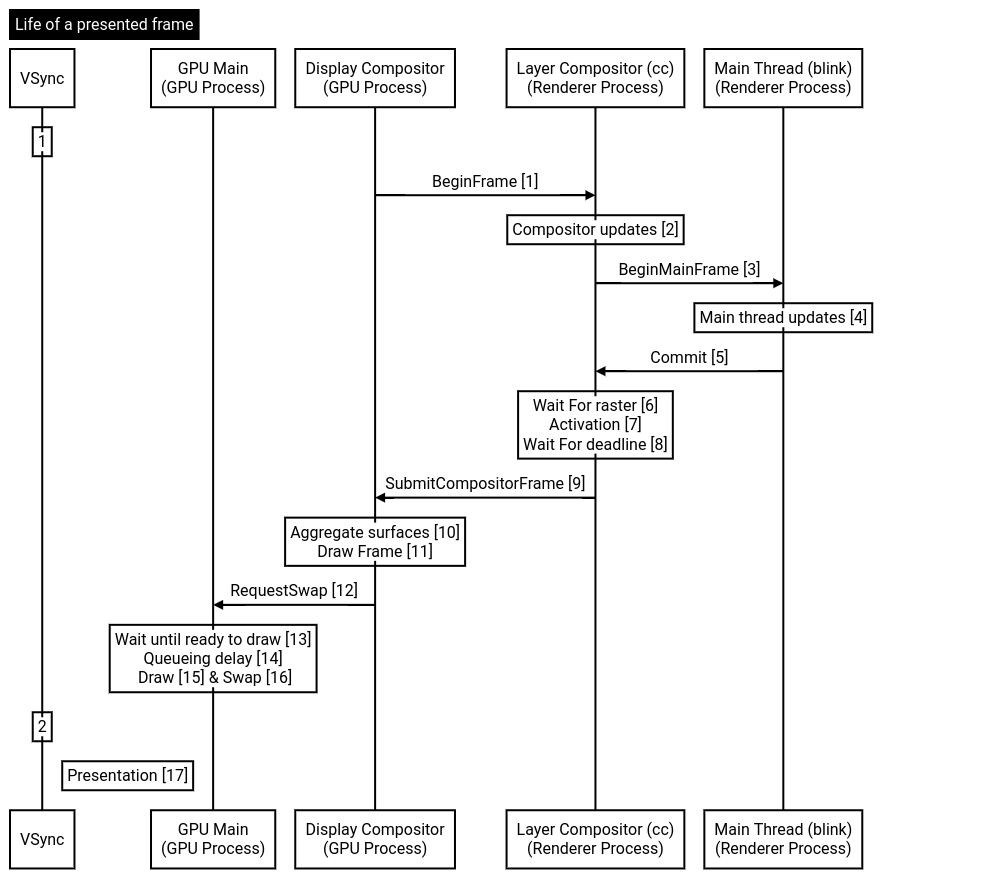
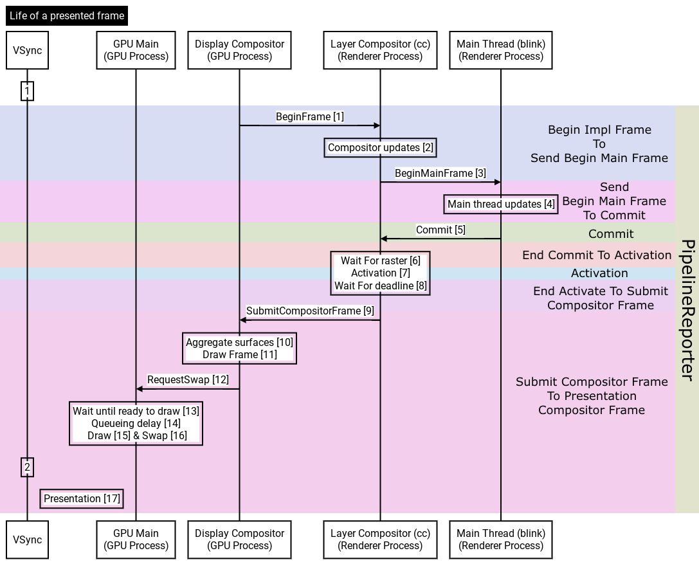
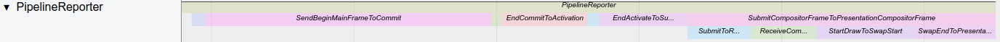
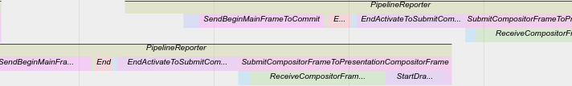
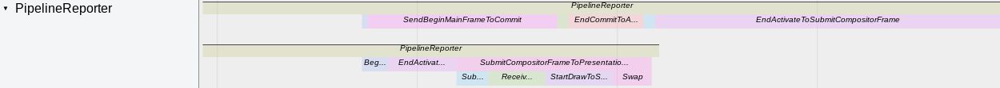
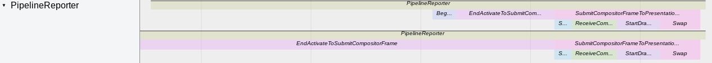

> 英文原文：[本地副本](../en/rendering/life_of_a_frame.md) · [Chromium 来源](https://chromium.googlesource.com/chromium/src/+/f5a9dd28d9af3a5450afb58ac199223fc6b49976/docs/life_of_a_frame.md)。对应本地源码提交 `f5a9dd28d9af`（2026-09-12）；翻译日期：2026-10-09。代码、标识符及源码注释保留原样，译者补充以“译注”标识。

# 一帧的生命周期

[原始 Google 文档](https://docs.google.com/document/d/1y6ZlGc2uH4ZBIrpEVM_wmfHgyvrcQG3LPRzG32FuVkQ/edit?usp=sharing)

- [步骤](#steps)
  - [`[1]` BeginFrame](#1-beginframe)
  - [`[2]` 合成器更新](#2-compositor-updates)
  - [`[3]` BeginMainFrame](#3-beginmainframe)
  - [`[4]` 主线程更新](#4-mainthreadupdates)
  - [`[5]` Commit](#5-commit)
  - [`[6]` 等待栅格化](#6-wait-for-raster)
  - [`[7]` Activation](#7-activation)
  - [`[8]` 等待截止时间](#8-wait-for-deadline)
  - [`[9]` SubmitCompositorFrame](#9-submitcompositorframe)
  - [`[10]` AggregateSurfaces](#10-aggregatesurfaces)
  - [`[11]` Draw Frame](#11-draw-frame)
  - [`[12]` RequestSwap](#12-requestswap)
  - [`[13]` 等待绘制条件就绪](#13-wait-until-ready-to-draw)
  - [`[14]` 排队延迟](#14-queueing-delay)
  - [`[15]` GPU 绘制](#15-gpu-draw)
  - [`[16]` Swap](#16-swap)
  - [`[17]` Presentation](#17-presentation)
- [PipelineReporter trace 事件](#pipelinereporter-trace-events)
- [相互重叠的 PipelineReporter 事件](#overlapping-pipeline-reporter-events)
  - [示例 1](#example-1)
  - [示例 2](#example-2)
  - [示例 3](#example-3)

> 译注：本文按原文介绍流水线及 trace 阶段。DDL、后端实现和不同平台的呈现时间获取方式均有版本背景；这些步骤不是 Web 标准承诺的事件顺序。

## 步骤

### `[1]` BeginFrame

每次 vsync 时，`BeginImplFrame` 启动一个合成器帧。它会在截止时间前等待 `BeginMainFrame` 和激活完成；超时后则绘制异步动画以及滚动、双指缩放更新。

### `[2]` 合成器更新

Impl 线程上的所有更新，例如滚动和缩放动画。

### `[3]` BeginMainFrame

如果主线程存在需要更新的内容，就发送 `BeginMainFrame`；否则跳过步骤 [3]、[4]、[5]。相关判断见 `SchedulerStateMachine::ShouldSendBeginMainFrame()`。

### `[4]` 主线程更新

主线程上的所有更新，例如 `HandleInputEvents`、`Animate`、`StyleUpdate` 和 `LayoutUpdate`。

### `[5]` Commit

将更新提交回 Impl 线程，以便激活。具体来说，主线程将自己持有的图层树复制到 Impl 线程的 pending tree（`pending_tree_`）。复制期间主线程被阻塞。

### `[6]` 等待栅格化

栅格化可以在其他线程异步执行，甚至在另一个进程执行，即 OOP-R（进程外栅格化）。如果无法在激活截止时间之前完成栅格化，就不会执行步骤 [7] 中从 pending tree 到 active tree 的复制，而是直接进入步骤 [8]，使用活动树中已有的内容。

### `[7]` Activation

激活将图层树和属性从 pending tree 推送到 active tree（`active_tree_`）。注意 Impl 线程也能直接修改活动树，以反映步骤 [2] 中自身产生的更新。

### `[8]` 等待截止时间

提交合成器帧的截止时间由 GPU 进程提供，见 `Scheduler::BeginImplFrameWithDeadline()`。

### `[9]` SubmitCompositorFrame

所有已激活的更新都将基于活动树内容生成一个合成器帧，提交给 GPU 进程。如果步骤 [2]、[3]、[4]、[5]、[6] 中某一步耗时过长，导致它负责的更新未能在截止时间前进入活动树，流水线仍会提交现有活动树，只是不包含该更新。这是产生丢帧的一种原因。

### `[10]` AggregateSurfaces

各客户端提交 `CompositorFrame` 或发出 `DidNotProduceFrame` 后，显示合成器便可以绘制。如果 `DisplayScheduler` 到达截止时间，即使仍在等待其他客户端，只要已有客户端提交了新帧，它仍会绘制。

实际绘制前，`SurfaceAggregator` 递归遍历合成器帧，用嵌入帧的内容替换 `SurfaceQuad`（由 `SurfaceLayer` 产生的 quad）。最终得到一个可供显示合成器绘制的 `CompositorFrame`。

### `[11]` Draw Frame

显示合成器遍历聚合帧中的 quad 和 render pass，生成绘制命令。对于原文中的 `SkiaRenderer`，这一步录制 Deferred Display List（DDL，延迟显示列表）。

### `[12]` RequestSwap

录制好的命令会提交到 GPU 线程重放，并附带 `SwapBuffers` 请求，以将结果显示到屏幕。

### `[13]` 等待绘制条件就绪

绘制提交到 GPU 主线程时，某些资源可能尚未就绪。Chrome 使用 `SyncToken` 保证这种同步。步骤 [12] 提交的 GPU 任务只有在所有关联的 `SyncToken` 都发出信号后，才会被调度。

### `[14]` 排队延迟

GPU 主线程处理所有 GPU 相关工作。显示合成器准备好绘制时，它可能仍在执行其他任务，例如下一帧的栅格化。`gpu::Scheduler` 使用协作式多任务调度，除非当前任务主动让出执行权，否则无法抢占。因此，显示合成器提交的任务可能需要等待当前任务，以及其他更高优先级的任务完成。

### `[15]` GPU 绘制

显示合成器投递到 GPU 主线程的任务终于执行，重放步骤 [11] 录制的绘制命令。对于 `SkiaRenderer`，Skia 重放 DDL 并向 GPU 发出命令。这一步才真正把工作提交给 GPU 硬件，而非仅提交给运行在 CPU 上的 GPU 线程。

### `[16]` Swap

GPU 工作已提交，此时发出呈现结果的请求：在向 framebuffer 或 overlay 绘制新内容后，请求显示它们。根据平台不同，这一步可能阻塞，也可能不阻塞，并可能花费较长时间。例如排队等待 swap 的请求过多时，它可能一直阻塞到下一次 vblank。

### `[17]` Presentation

GPU 已完成工作，显示控制器开始扫描输出结果，像素终于显示在屏幕上。部分平台在此之前还需要由系统合成器处理。

并非所有平台都能获取精确的呈现时间，Chrome 会尽力估算。例如原文中 macOS 在缺乏更好信息时使用 swap 时间；也可能将 GPU 完成时间对齐到下一个 vblank，或者由操作系统直接提供内容显示的准确时间。

## PipelineReporter trace 事件

Trace 中名为 **PipelineReporter** 的事件展示每一帧的多个流水线阶段，包括：

- `BeginImplFrameToSendBeginMainFrame`
- `SendBeginMainFrameToCommit`
- `Commit`
- `EndCommitToActivation`
- `Activation`
- `EndActivateToSubmitCompositorFrame`
- `SubmitCompositorFrameToPresentationCompositorFrame`

下图展示流水线各段如何对应到 PipelineReporter 事件。

在 trace 中，它们呈现为：

每一段的长度代表相应阶段的延迟。`SubmitCompositorFrameToPresentationCompositorFrame` 还包含以下子阶段：

- `SubmitToReceiveCompositorFrame`：提交消息的通信时间，步骤 [9]。
- `ReceiveCompositorFrameToStartDraw`：步骤 [10] 到 [14] 的耗时。
- `StartDrawToSwapStart`：GPU 主线程上 Draw 的耗时，步骤 [15]。
- `Swap`：GPU 主线程上 Swap 的耗时，步骤 [16]。
- `SwapEndToPresentationCompositorFrame`：直到实际呈现之前的剩余时间，步骤 [17]。

## 相互重叠的 PipelineReporter 事件

由多个进程处理帧的一个好处是能够同时处理多帧，这会让一些 PipelineReporter 事件发生重叠。下面给出几个例子。

### 示例 1

下方的 PipelineReporter（PR）启动得更早。当它处于 `EndActivateToSubmitCompositorFrame` 时，下一帧的 vsync 到来。此时合成器线程已完成激活，正在等待提交帧的截止时间，因此可以开始处理第二帧，即上方 PR。

到达第 1 帧的提交截止时间时，第 2 帧正在主线程执行 `SendBeginMainFrameToCommit`。第 1 帧会被提交，第 2 帧继续推进，并在下一个 vsync 提交。

### 示例 2

两个 PR 同时开始，却不会同时结束。查看参数可发现两者具有相同的 sequence number；对应同一次 vsync、同时启动的 PR 应当如此。

上方 PR 仍处于 `SendBeginMainFrameToCommit` 时，下方 PR 已进入 `EndActivateToSubmitCompositorFrame`，随后进入 `SubmitCompositorFrameToPresentationCompositorFrame`。这表明主线程工作尚未完成就已到达截止时间，因此先提交准备好的合成器更新（下方 PR）。上方 PR 会在下一次 vsync 对主线程更新执行同样的提交。

### 示例 3

两个 PR 在不同时间开始，却在同一时间结束。这通常发生在某个 PR 超过一个 vsync 周期时：它的最后阶段，例如 `SubmitCompositorFrameToPresentationCompositorFrame`，与下一个 PR（图中上方 PR）同步。

此时两个 PR 的更新会合并提交给 GPU 进程，并一起呈现。
