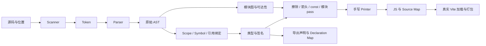

# 分层架构与编译概念

## 从输入到输出

前端识别语言结构与语义：scanner、parser、binder、checker。中间表示承载后续分析/转换的信息；本项目直接使用有范围的 AST，因为目标仍是源码到源码，表达式和声明结构可直观阅读，不需要为寄存器分配或机器优化建立额外 IR。后端 printer 将转换后的 AST 打印为目标 JS，同时记录映射。模块可达性是基于已绑定 AST 的全程序分析，默认先分析 ESM，再转目标模块格式。

## 公共协议和阶段依赖

[model.ts](../src/model.ts) 为所有阶段共享节点、位置、诊断、类型与选项。包和 infra 的迁移边界见[迁移清单](infra-migration.md)。`analyze` 返回 Source、Token、原始 AST、绑定表、检查结果；`compile` 再返回各 pass 的 AST、代码与标准 map。`Map<Identifier, BindingSymbol>` 按节点身份绑定引用，避免把同名局部变量误当成一个名称；类型附在原始表达式与符号上，不污染 printer。

| 阶段 | 核心输入 → 输出 | 保证与教学简化 | 测试 |
| --- | --- | --- | --- |
| P0 | 公共协议 → workspace 主体 | 直接 Node 执行可擦除 TS，Vite 构建 JS，tsc 检查类型并生成声明 | 根与各包 typecheck/build |
| P1 | UTF-16 → Token → AST | 递归下降、首个语法错误停止，无完整 JS 词法上下文 | core 中范围/优先级/非法输入 |
| P2 | AST → Scope/Symbol → Type | 顺序激活、闭包/遮蔽、精确基本类型，无 CFG | core 中名称/初始化/调用/返回错误 |
| P3 | 已检查 AST → 独立 pass → JS | 不可变 rewrite，不允许绕开 Binder 的安全前提 | core 中实际输出和原树保留 |
| P4 | 原范围 + 转换来源 + 生成位置 → map | 明确 token/表达式映射，新增文字无映射 | maps 中精确查询 |
| P5 | 导入 AST → DAG → 固定点保留集合 | DFS 拒绝环，副作用保守，保留空模块求值壳 | modules 中双格式、顺序和传递引用 |
| P6 | 导出符号与类型 → 声明/map | 只打印原始类型和直接导出的箭头 | maps 中签名和声明查询 |
| P7 | 插件原始 TS → ESM/map → Vite | pre hook + 精确过滤，真实 build / dev | vite 中钩子证据和组合 map |

Visitor 的 `walk` 遍历所有结构节点；Binder 单独区分声明位置、引用位置与成员名。Transform 的 `rewrite` 是自底向上的不可变重建；各 pass 共用 AST 协议，原始 Token/AST 可在 inspect 实验中单独观察。[真实阶段入口](references.md)说明工程实现如何处理恢复、性能与更多语义。

## 转换的前提

类型擦除只移除标注，不决定类型是否正确。Checker 已将 `age: number = "18"` 诊断为错误，擦除本身无法发现这个矛盾。Babel 的 TS 语法插件可识别与擦除标注，也不能因此替代完整 tsc Checker。

箭头具有词法 `this/arguments/super/new.target`、不可作为构造函数等语义。这里从语言入口拒绝那些观察路径；函数体只能是表达式，因此降级为 `function (...) { return expression; }` 成立。真实 Babel/tsc 要处理捕获、helper、调用上下文和其他嵌套语义。

`const` 有不可重新赋值、块作用域和 TDZ；`var` 是函数作用域、声明提升。这里无赋值、无块/循环，所有未来声明引用连同延迟捕获都拒绝；唯一的函数局部声明是参数。生成文件由 playground 脚本作为 Node 模块运行，Vite 也以 ESM 加载，不承诺把产物作为 classic script 时的全局属性行为。上述前提才使 `const→var` 的示例降级可比较。真实工程需要考虑循环逐次绑定、名称碰撞、控制流和声明提升。

语法转换改变表达形式；polyfill 提供运行时不存在的 API。把箭头改成普通函数不会自动提供 `Promise/Map/fetch`。本编译器不注入 polyfill；Vite 自带的 modulepreload 支持代码来自真实构建工具，也不意味着本编译器实现了运行时兼容层。

## tsc、Babel、SWC、GCC 与 JS 引擎

| 工具 | 代表性架构与工程取舍 |
| --- | --- |
| TypeScript 6.0.3 | TS 实现的 scanner/parser/binder/checker/transform/emitter；跨文件类型信息、声明生成、缓存和语言服务使实现复杂 |
| Babel 7.28.5 | parser + traversal/NodePath + 插件 visitor + generator；可组合 AST 插件方便生态扩展，但并不实现完整 TS 类型检查 |
| SWC | Rust 的 parser/AST/visitor/transform/codegen，原生接口与并行处理减少 JS 层开销；性能还受工作量、插件与序列化影响，不能用一个倍率概括 |
| GCC | 前端后有 GENERIC/GIMPLE/RTL 等不同抽象层的 IR，机器后端还需寄存器分配与指令选择；输出目标代码的约束与 JS printer 不同 |

SWC 的 parser/transform/codegen 配置与接口可见[官方编译配置](https://swc.rs/docs/configuration/compilation)和 [Compiler Rust API](https://rustdoc.swc.rs/swc/struct.Compiler.html)。这里只对照文档，没有克隆 Rust 仓库，也没有把 SWC 用作核心依赖。GCC 的三地址 IR 与目标相关 IR 见 [GIMPLE](https://gcc.gnu.org/onlinedocs/gcc-4.9.4/gccint/GIMPLE.html) 和 [RTL](https://gcc.gnu.org/onlinedocs/gccint/RTL.html)。

tsc/Babel 输出的 JS 仍由 JS 引擎解析、编译并执行。本项目没有实现解释器或 JIT。[V8 的 Ignition 说明](https://v8.dev/docs/ignition)与 [Maglev 文档](https://v8.dev/blog/maglev)展示字节码解释、优化编译与执行反馈的关系；优化失败时还涉及去优化。静态/动态描述类型与检查时机，编译/解释描述执行路径，不能说“动态语言不编译，静态语言才编译”。这两组概念相互独立。
